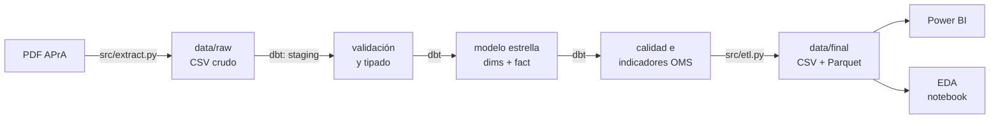

# ¿Cuán lejos está el aire porteño de las guías de la OMS?

Trabajo Práctico Integrador de **Análisis de Datos** (Licenciatura en Ciencia de Datos). Flujo completo: datos
públicos de calidad del aire → extracción → modelo en DuckDB → limpieza y calidad → ETL con dbt → consultas SQL →
EDA en Python → dashboard en Power BI.

**Rol:** equipo de datos de una agencia de calidad ambiental. **Público:** funcionarios, prensa y ciudadanía.

## Pregunta

> ¿Cuán lejos está la calidad del aire de la Ciudad de Buenos Aires de las guías de calidad del aire de la OMS
> (2021), y cómo varía esa brecha entre estaciones, contaminantes, tipo de día y período?

1. ¿Qué porcentaje de días se supera la guía diaria de la OMS, por estación y contaminante?
2. ¿Cuántas veces por encima de la guía anual están los promedios anuales?
3. ¿Qué estación tiene la peor situación y con qué contaminante?
4. ¿Cambia el cumplimiento entre días hábiles, sábados, domingos y feriados?
5. ¿Hay estacionalidad (invierno vs. verano)?
6. ¿Cuánto condiciona la calidad o completitud de los datos a las conclusiones?

**Hipótesis:**
- **H1:** el NO₂ es el contaminante más crítico: el que más se aleja de las guías de la OMS.
- **H2:** Córdoba, la estación ubicada sobre una avenida de tránsito intenso, es la más comprometida en NO₂.
- **H3:** los domingos y feriados la brecha se reduce de forma visible.

Son las expectativas previas al análisis: el NO₂ sale sobre todo de los motores (en especial diésel) y Córdoba es la
estación que la APrA describe con flujo vehicular alto.

**Por qué importa:** la OMS actualizó sus guías en 2021 y las hizo mucho más exigentes (la de NO₂ anual pasó de 40 a
10 µg/m³). La norma de la Ciudad sigue valores más laxos, así que "cumplir la norma" no dice cuán lejos se está de
lo que la evidencia en salud considera seguro.

**Los escalones de la OMS.** La guía (AQG) es el nivel sin riesgo apreciable y es muy exigente; por eso la OMS
define **objetivos intermedios** para medir el avance: IT1 (el menos exigente) … IT4 (el más cercano a la guía).
NO₂: guía diaria 25 µg/m³, IT2 50, IT1 120; guía anual 10, IT3 20, IT2 30, IT1 40. La pregunta no es solo
"¿cumple o no?", sino **"¿en qué escalón está?"**.

## Hallazgos

Período 2024-01-01 a 2026-09-30, estaciones Parque Centenario, Córdoba y La Boca de la APrA.

| | NO₂ | PM10 | CO |
|---|---|---|---|
| Escalón OMS anual (últimos 12 meses) | **IT2** (Centenario) · **IT1** (Córdoba) · **> IT1** (La Boca) | IT3 en las tres | — |
| Días que cumplen el IT2 diario (50 µg/m³) | 98,6% (Centenario) · 87,7% (Córdoba) · 49,7% (La Boca) | — | — |
| Días que cumplen la guía de 24 h | 50% (Centenario) · 16% (Córdoba) · 5% (La Boca) | 96% a 98% | 100% |
| Promedio de los últimos 12 meses vs. guía anual | 2,6 a 4,6 veces | 1,5 a 1,8 veces | sin guía anual |
| Percentil 99 anual vs. guía de 24 h | 1,7 a 4,2 veces | 1,0 a 1,4 veces | menos de 0,4 veces |

1. **Ninguna estación cumple la guía de NO₂, pero dos están en escalones intermedios.** Parque Centenario cumple el
   IT2 anual (26,2 µg/m³) y el IT2 diario el 98,6% de los días; Córdoba cumple el IT1 anual (35,0 µg/m³) y el IT2
   diario el 87,7% de los días. A cada una le faltan 5 a 6 µg/m³ de promedio anual para subir un escalón.
2. **La Boca no alcanza ni el primer escalón:** su NO₂ de los últimos 12 meses es 45,9 µg/m³ (4,6 veces la guía
   anual), por encima del IT1 (40 µg/m³), y solo la mitad de los días cumple el IT2 diario. En 2024 llegó a
   56,5 µg/m³. Estuvo **216 días seguidos** por encima de la guía diaria (marzo a octubre de 2025).
3. **El PM10 casi nunca supera la guía diaria, pero tampoco cumple:** su promedio anual está 1,5 a 1,8 veces por
   encima de la guía y su percentil 99 (la definición formal de la guía de 24 h) también la supera.
4. **Los domingos el NO₂ baja entre 17% y 27%, pero la brecha no se cierra:** en La Boca el 90% de los domingos
   sigue sobre la guía.
5. **Estacionalidad fuerte:** en invierno el NO₂ de La Boca es 1,8 veces el del verano y supera la guía el 99,6%
   de los días.
6. **La Boca mejora año a año en el escalón diario:** cumple el IT2 diario el 40% de los días en 2024, el 54% en
   2025 y el 58% en 2026 (enero a septiembre). Su promedio anual sigue por encima del IT1 y, sin meteorología, la
   mejora no se puede atribuir a menos emisiones. Ver la matriz de escalones
   ([`reports/figures/06b_matriz_niveles_no2.png`](reports/figures/06b_matriz_niveles_no2.png)).
7. **Los huecos de datos cambian conclusiones:** la "caída" del NO₂ de 2024 a 2026 (−28% juntando las estaciones)
   está inflada porque en 2024 casi no hay datos de Centenario, la estación más limpia. Por estación: La Boca −20%,
   Córdoba −14% y Centenario sin tendencia. Y sin controlar la meteorología no se puede atribuir a una mejora real.

**Hipótesis:**
- **H1 se sostiene:** el NO₂ supera la guía diaria el 50% a 95% de los días, contra 2% a 4% del PM10 y 0% del CO;
  su promedio anual está 2,6 a 4,6 veces sobre la guía (PM10: 1,5 a 1,8).
- **H2 no se sostiene:** la más comprometida es **La Boca**, con todos los indicadores; Córdoba queda segunda. La
  Boca tiene flujo vehicular medio-bajo pero fuentes fijas cercanas (puerto, polo de Dock Sud, tránsito pesado) y es
  la que menos baja el domingo: el tránsito de la avenida no explica todo.
- **H3 se sostiene a medias:** baja el nivel, pero en La Boca el incumplimiento sigue.

Detalle: [`notebooks/eda.ipynb`](notebooks/eda.ipynb) (EDA y conclusiones) y
[`sql/99_consultas_analisis.sql`](sql/99_consultas_analisis.sql) (las mismas respuestas en SQL).

## Cómo cubre el TP la consigna

| Etapa de la consigna | Dónde está |
|---|---|
| 1. Problema, pregunta e hipótesis | Este README (pregunta, subpreguntas, hipótesis, rol y público) |
| 2. Selección, recolección y comprensión del dataset | Sección [Datos](#datos) y [`docs/calidad_datos.md`](docs/calidad_datos.md) §1 (fuente, formato, registros, columnas, granularidad, período, limitaciones) |
| 3. Almacenamiento y modelado | DuckDB + [`docs/modelo_datos.md`](docs/modelo_datos.md) (qué representa cada tabla, claves, relaciones, decisiones) |
| 4. Consultas SQL | [`sql/99_consultas_analisis.sql`](sql/99_consultas_analisis.sql) (cada consulta dice qué responde, por qué y qué técnica usa) y los modelos de `dbt/models/` |
| 5. Limpieza, calidad y normalización | [`docs/calidad_datos.md`](docs/calidad_datos.md) (nulos, duplicados, tipos, fechas, categorías, atípicos, redundancias, formato, unidades) y `dbt/models/01_staging/` |
| 6. Flujo ETL | [`docs/diagrama_etl.md`](docs/diagrama_etl.md), `src/extract.py`, `src/etl.py` y `dbt/` |
| 7. EDA en Python | [`notebooks/eda.ipynb`](notebooks/eda.ipynb) (Sweetviz + pandas, matplotlib y seaborn) |
| 8. Visualizaciones e indicadores | `reports/figures/`, `indicadores.*` (cumplimiento diario, anual, escalones, rachas) |
| 9. Dashboard en Power BI | [`dashboard/AireOMS.pbip`](dashboard/) (modelo, relaciones y medidas DAX listos) + [`docs/powerbi_spec.md`](docs/powerbi_spec.md) (qué gráficos van en cada página) |
| 10. Hallazgos, conclusiones y limitaciones | Secciones [Hallazgos](#hallazgos) y [Limitaciones](#limitaciones), notebook §11 y presentación |

**Entregables:** dashboard (Power BI), notebook, scripts (`src/`, `dbt/`), consultas SQL, archivos procesados
(`data/final/`), diagrama del ETL, documentación del proceso (`docs/`), dataset final para Power BI y presentación
(`presentacion/`).

## Cómo correrlo

Requisitos: Python 3.11 o superior y Git. Todo corre local, sin servidores.

```bash
git clone https://github.com/ezequielmaranda/nox-ciudad
```

```bash
cd nox-ciudad
```

```bash
make install
```

```bash
make all
```

`make all` corre el ETL (crudo → DuckDB → `data/final/`), los tests y el notebook de EDA (regenera
`reports/figures/`). Tarda menos de un minuto. Por partes: `make etl`, `make test`, `make eda`; `make docs` abre la
documentación de dbt con el linaje de las tablas; `make extract` vuelve a bajar los PDF de la APrA (opcional: el
CSV crudo ya está en el repo).

**En Windows** (sin `make`), desde la raíz del repo:

```bash
python -m venv .venv
```

```bash
.venv\Scripts\pip install -r requirements.txt
```

```bash
.venv\Scripts\python -m src.etl
```

```bash
.venv\Scripts\python -m pytest -q
```

```bash
.venv\Scripts\python -m jupyter nbconvert --to notebook --execute --inplace notebooks/eda.ipynb
```

Para explorar la base con SQL: abrir `data/warehouse/aire.duckdb` en DBeaver o DataGrip (driver DuckDB 1.x) o con la
CLI de DuckDB, y correr `sql/99_consultas_analisis.sql`.

## Estructura

```
.
├── README.md                      este archivo
├── requirements.txt · Makefile · pytest.ini
├── data/
│   ├── raw/                       crudo de la extracción (no se modifica a mano)
│   │   ├── aire_publico.csv           83.010 valores de 279 PDF de la APrA, todo texto
│   │   └── aire_publico_manifiesto.csv  estado de cada PDF (procesado, aviso, descartado)
│   ├── reference/                 tablas mantenidas a mano: guías OMS, estaciones, contaminantes, feriados, eventos
│   ├── warehouse/aire.duckdb      base generada por el ETL (fuera de git)
│   └── final/                     18 tablas en CSV y Parquet para Power BI y el EDA
├── dbt/                           transformaciones SQL (dbt + DuckDB)
│   ├── models/01_staging/         tipar, normalizar, reglas de validación física
│   ├── models/02_dimensiones/     calendario, estación, contaminante, período, evento, referencias OMS
│   ├── models/03_hechos/          fact_medicion_diaria (formato largo, grilla completa)
│   ├── models/04_calidad/         completitud, regla del 75%, violaciones, outliers
│   ├── models/05_indicadores/     cumplimiento diario, indicadores anuales, rachas
│   └── tests/                     tests de calidad (singulares y genéricos)
├── sql/99_consultas_analisis.sql  consultas comentadas que responden cada subpregunta + vistas
├── src/
│   ├── config.py                  rutas relativas a la raíz y tablas a exportar
│   ├── extract.py                 extracción: PDF de la APrA → data/raw/aire_publico.csv
│   ├── etl.py                     orquesta extract → dbt build → export → consultas → diccionario
│   ├── calidad.py                 perfil del crudo y resumen de calidad
│   ├── diccionario.py             genera docs/diccionario_datos.md
│   └── generar_pbip.py            genera el proyecto de Power BI (dashboard/)
├── notebooks/eda.ipynb            EDA ordenado por subpregunta
├── tests/test_etl.py              tests de pytest: idempotencia, sql/99 y extractor (los de datos están en dbt)
├── docs/                          diagrama ETL, modelo de datos, calidad, diccionario, spec de Power BI
├── dashboard/AireOMS.pbip         proyecto de Power BI: modelo, relaciones y medidas listos (se abre con Power BI Desktop)
├── presentacion/                 presentación (.pptx, 19 slides) con el guion de cada integrante en las notas
└── reports/
    ├── figures/                   figuras del EDA (PNG)
    └── sweetviz_*.html            perfil automático del EDA (Sweetviz)
```

## Datos

| | |
|---|---|
| **Fuente** | Agencia de Protección Ambiental (APrA), Gobierno de la Ciudad de Buenos Aires: informes mensuales de las estaciones de monitoreo ([buenosaires.gob.ar/calidad-del-aire](https://buenosaires.gob.ar/calidad-del-aire)) |
| **Formato original** | PDF, uno por mes, contaminante y estación (281 enlazados; 279 procesados, 2 descartados) |
| **Volumen** | 83.010 valores crudos → fact de 30.120 filas (1.004 días × 3 estaciones × 5 contaminantes × 2 ventanas) |
| **Variables** | NO, NO₂, NOx (ppb), CO (ppm), PM10 (µg/m³); por día: promedio de 24 h, bloques de 8 h, máximo y mínimo horario |
| **Granularidad** | estación × día (los datos horarios no son públicos) |
| **Período** | 2024-01-01 a 2026-09-30 (2026 parcial) |
| **Referencia** | Guías OMS 2021 (`data/reference/oms_2021.csv`), usadas siempre vía JOIN |
| **Complementos** | Feriados nacionales (API ArgentinaDatos) y días de paro de transporte (notas de prensa) |

## Flujo técnico



Detalle de cada paso: [`docs/diagrama_etl.md`](docs/diagrama_etl.md). Modelo y decisiones:
[`docs/modelo_datos.md`](docs/modelo_datos.md). Calidad: [`docs/calidad_datos.md`](docs/calidad_datos.md).
Columnas: [`docs/diccionario_datos.md`](docs/diccionario_datos.md). Dashboard:
[`docs/powerbi_spec.md`](docs/powerbi_spec.md).

## Decisiones técnicas clave

| Decisión | Por qué |
|---|---|
| **EDA en dos pasos:** perfil automático con **Sweetviz** y después EDA guiado por las subpreguntas (**pandas**, **matplotlib**, **seaborn**) | Sweetviz da un barrido rápido de tipos, nulos, distribuciones y asociaciones, pero no conoce la guía OMS ni la regla del 75%: el análisis de fondo se hace a mano |
| **Partir de los PDF públicos** y no de una tabla ya procesada | La consigna pide un flujo completo y desaconseja datasets ya procesados. Desde el PDF aparecen los problemas reales: `s/d`, `<4`, coma decimal, archivos de otra estación, valores incoherentes |
| **DuckDB** | Base analítica en un archivo, sin servidor, que lee CSV/Parquet y usa SQL estándar. Lo específico de DuckDB está comentado para portar a otro motor |
| **dbt** para las transformaciones | Cada tabla es un `SELECT` en un `.sql` legible; dbt las corre en orden, ejecuta 79 tests de calidad en cada build y documenta el linaje. Es una librería de Python, no infraestructura |
| **Esquema estrella, fact en formato largo** | El JOIN con la OMS es por contaminante; en Power BI un segmentador elige el contaminante; agregar uno no cambia la estructura |
| **dbt prueba los datos, pytest el código** | Los tests de datos viven en un solo lugar (dbt). pytest cubre lo que dbt no puede: idempotencia del pipeline, las consultas de `sql/99` y las funciones del extractor |
| **Fact como grilla completa** (calendario × estación × contaminante) | Distingue "la fuente no publicó" de "publicó `s/d`" y de "lo descartó una regla"; la completitud es un promedio |
| **No se borra nada:** se marca | Cada problema queda en una columna (`motivo_sin_dato`, `es_outlier`); el análisis decide |
| **Umbrales en tablas** | Guías OMS, tolerancias, factores de conversión y parámetros (75%, 3·IQR) en `data/reference/` y `dbt_project.yml`, nunca escritos en el SQL |
| **`<límite de detección` → límite / 2** | El valor real está entre 0 y el límite; descartarlo sesgaría los promedios hacia arriba |
| **La incoherencia NOx ≠ NO + NO₂ descarta NO y NOx, no NO₂** | Se concentra en el día 8 de cada mes con el NO "trabado"; el NO₂ pasa sus propios controles |
| **Outliers: Q3 + 3·IQR, marcados** | Los más extremos ocurren a la vez en las tres estaciones: son episodios reales, justo lo que la guía de 24 h quiere detectar |
| **Regla del 75%** para indicadores anuales (criterio de la EPA; la OMS no fija uno) | Un promedio con meses faltantes puede estar sesgado por la estación del año. La UE pide 90%: se probó la sensibilidad y los escalones de cada estación no cambian (`docs/calidad_datos.md` §3) |
| **% de días sobre la guía con denominador = días con dato** | Un día sin dato no es un día limpio |
| **Dos métricas para la guía de 24 h:** % de días y percentil 99 | La OMS define la guía de 24 h como el P99 anual; el % de días es más fácil de comunicar |
| **Últimos 12 meses** además de los años calendario | 2026 llega a septiembre: sin primavera ni verano no es comparable con un año completo |

## Limitaciones

- **Solo 3 estaciones:** no representan a toda la Ciudad (no hay estaciones en el sudoeste ni en el norte).
- **Huecos de datos:** el NO₂ de Parque Centenario falta de marzo a noviembre de 2024 y en julio de 2025; los
  indicadores anuales con menos de 75% de días no se calculan. Tampoco se puede verificar cuántas horas tuvo cada
  promedio diario de la APrA (el criterio de 18 de 24 horas de las normas).
- **2026 es parcial** (enero a septiembre).
- **Sin control meteorológico:** las diferencias entre períodos o épocas del año pueden deberse al clima (viento,
  lluvia, inversiones térmicas).
- **El "% de días sobre la guía" es una simplificación:** la guía de 24 h de la OMS es estadísticamente un
  percentil 99 anual (se reportan las dos métricas).
- **Datos agregados aguas arriba:** la APrA mide cada hora y publica promedios diarios y por bloques de 8 h,
  redondeados. El ETL del TP arranca de esos informes; no hay acceso a los datos horarios ni a los registros de
  calibración que explicarían el patrón del día 8.
- **Conversión de unidades** a 25 °C y 1 atm (convención OMS); la temperatura real cambia levemente los µg/m³.
- **Ubicación de las estaciones aproximada** (geocodificada a mano desde la dirección).

**Mejoras futuras:** sumar meteorología (viento, lluvia, temperatura) para separar clima de emisiones; pedir a la
APrA los datos horarios; agregar O₃ y PM2.5 si se publican; automatizar la extracción mensual.

## Exposición (20 minutos, 4 integrantes)

Presentación: [`presentacion/presentacion_tp_aire_oms.pptx`](presentacion/presentacion_tp_aire_oms.pptx) (se puede importar en Google Slides). Cada slide tiene en las notas el guion de quien la presenta.

| Bloque de la consigna | Contenido | Material | Quién (propuesta) |
|---|---|---|---|
| 1-2. Caso, pregunta e hipótesis | Por qué la OMS 2021, rol y público | este README | Integrante 1 |
| 3. Dataset | PDF de la APrA, grano, período, limitaciones iniciales | `docs/calidad_datos.md` §1 | Integrante 1 |
| 4-5. Flujo técnico y calidad | Extracción, dbt, esquema estrella, reglas, día 8, regla del 75%, heatmap | `docs/diagrama_etl.md`, `docs/modelo_datos.md`, figura 01 | Integrante 2 |
| 6. EDA | Distribuciones, series, tipo de día, estacionalidad, efecto de los huecos | `notebooks/eda.ipynb` | Integrante 3 |
| 7-8. Dashboard e insights | Las 3 páginas de Power BI y los 6 hallazgos | `docs/powerbi_spec.md` | Integrante 4 |
| 9. Limitaciones y mejoras | Sección anterior | este README | Integrante 4 |

Cualquier integrante tiene que poder explicar cualquier parte: cada archivo SQL y Python está comentado en español
con el qué y el por qué.

## Fuentes

- World Health Organization (2021). *WHO global air quality guidelines: particulate matter (PM2.5 and PM10), ozone,
  nitrogen dioxide, sulfur dioxide and carbon monoxide.* Ginebra: OMS. ISBN 978-92-4-003422-8.
  <https://www.who.int/publications/i/item/9789240034228>. Valores de `data/reference/oms_2021.csv`: resumen
  ejecutivo, Tabla 0.1, *Recommended AQG levels and interim targets*.
- Agencia de Protección Ambiental, GCBA. Calidad del aire, estaciones Parque Centenario, Córdoba y La Boca.
  <https://buenosaires.gob.ar/calidad-del-aire>.
- ArgentinaDatos. API de feriados nacionales. <https://api.argentinadatos.com/v1/feriados/>.
