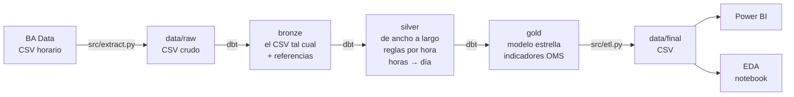

# ¿Cuán lejos está el aire porteño de las guías de la OMS?

Trabajo Práctico Integrador de **Análisis de Datos** (Licenciatura en Ciencia de Datos). Flujo completo: datos
públicos horarios de calidad del aire (BA Data) → extracción → ETL con dbt sobre DuckDB en arquitectura medallón
(bronze: el crudo · silver: limpieza y calidad · gold: modelo estrella e indicadores) → consultas SQL → EDA en
Python → dashboard en Power BI.

**Rol:** equipo de datos de una agencia de calidad ambiental. **Público:** funcionarios, prensa y ciudadanía.

## Pregunta

> ¿Cuán lejos está la calidad del aire de la Ciudad de Buenos Aires de las guías de calidad del aire de la OMS
> (2021), y cómo varía esa brecha entre estaciones, contaminantes, tipo de día y período?

1. ¿Qué porcentaje de días se supera la guía diaria de la OMS, por estación y contaminante?
2. ¿Cuántas veces por encima de la guía anual están los promedios anuales?
3. ¿Qué estación tiene la peor situación y con qué contaminante?
4. ¿Cambia el cumplimiento entre días hábiles, sábados, domingos y feriados?
5. ¿Hay estacionalidad (invierno vs. verano)?
6. ¿Cuánto condiciona la calidad o completitud de los datos a las conclusiones?

**Hipótesis:**
- **H1:** el NO₂ es el contaminante más crítico: el que más se aleja de las guías de la OMS.
- **H2:** Córdoba, la estación ubicada sobre una avenida de tránsito intenso, es la más comprometida en NO₂.
- **H3:** los domingos y feriados la brecha se reduce de forma visible.

**De dónde salen las hipótesis.** Una hipótesis es una respuesta tentativa a la pregunta. Se fundamenta con lo que se
sabe **antes** de analizar los datos (un mecanismo conocido, antecedentes, normas, la descripción de las estaciones) y
tiene que poder resultar falsa. No se arma mirando los resultados, porque sería circular.

Las tres nuestras salen de una misma premisa: **en la Ciudad, el NO₂ proviene sobre todo del tránsito**. Bogo, Negri
y San Román (1999) midieron un año de CO y NOx sobre una avenida porteña y encontraron que el tránsito es la fuente
principal. Cada hipótesis aplica esa premisa a uno de los cortes de la pregunta:

| | Corte | Por qué la esperábamos | Qué otra respuesta era posible |
|---|---|---|---|
| **H1** | Contaminante | La OMS 2021 endureció el NO₂ mucho más que el resto: su guía anual pasó de 40 a 10 µg/m³ (4 veces más exigente) y se agregó una guía diaria de 25. La del PM10 pasó de 20 a 15 (anual) y de 50 a 45 (diaria). Además, las tres estaciones están en zonas con tránsito, la fuente del NO₂. | El PM10: en muchas ciudades el material particulado es el contaminante crítico. El CO era poco probable, porque los autos con catalizador emiten mucho menos. |
| **H2** | Estación | Si la fuente es el tránsito, la peor debería ser la estación con más tránsito. La APrA describe a Córdoba con "flujo vehicular alto y muy escasa incidencia de fuentes fijas", a Parque Centenario con flujo medio y a La Boca con flujo "medio-bajo e incidencia de fuentes fijas". En Europa, casi todas las superaciones del límite de NO₂ ocurren en estaciones de tránsito (EEA). | La Boca, si las fuentes fijas cercanas (puerto, polo de Dock Sud, tránsito pesado de acceso) pesan más que el tránsito de la avenida. |
| **H3** | Tipo de día | Si la fuente es el tránsito, cuando el tránsito baja (domingos y feriados) el NO₂ tiene que bajar. El "efecto fin de semana" del NO₂ está documentado, incluso desde satélite (Beirle et al., 2003). | Que baje poco, porque las fuentes fijas no descansan el domingo. |

El cuarto corte, **período**, quedó sin hipótesis: sin meteorología no hay base para anticipar un cambio ni para
atribuirlo, así que se trata como pregunta exploratoria (subpreguntas 5 y 6).

Como las tres comparten la premisa, el resultado conjunto también dice algo de ella. H1 se sostiene, H3 a medias y
H2 no, así que el tránsito explica buena parte del NO₂, pero no todo.

**Por qué importa:** la OMS actualizó sus guías en 2021 y las hizo mucho más exigentes (la de NO₂ anual pasó de 40 a
10 µg/m³). La norma de la Ciudad sigue valores más laxos, así que "cumplir la norma" no dice cuán lejos se está de
lo que la evidencia en salud considera seguro.

**Los escalones de la OMS.** La guía (AQG) es el nivel sin riesgo apreciable y es muy exigente; por eso la OMS
define **objetivos intermedios** para medir el avance: IT1 (el menos exigente) … IT4 (el más cercano a la guía).
NO₂: guía diaria 25 µg/m³, IT2 50, IT1 120; guía anual 10, IT3 20, IT2 30, IT1 40. La pregunta no es solo
"¿cumple o no?", sino **"¿en qué escalón está?"**.

## Hallazgos

Período 2024-01-01 a 2026-09-30, estaciones Parque Centenario, Córdoba y La Boca de la APrA.

| | NO₂ | PM10 | CO |
|---|---|---|---|
| Escalón OMS anual (últimos 12 meses) | **IT2** (Centenario) · **IT1** (Córdoba) · **> IT1** (La Boca) | IT3 en las tres | — |
| Días que cumplen el IT2 diario (50 µg/m³) | 98,5% (Centenario) · 87,6% (Córdoba) · 50,0% (La Boca) | — | — |
| Días que cumplen la guía de 24 h | 45% (Centenario) · 14% (Córdoba) · 5% (La Boca) | 96% a 98% | 100% |
| Promedio de los últimos 12 meses vs. guía anual | 2,6 a 4,6 veces | 1,4 a 1,8 veces | sin guía anual |
| Percentil 99 anual vs. guía de 24 h | 1,7 a 4,2 veces | 1,0 a 1,4 veces | menos de 0,4 veces |

1. **Ninguna estación cumple la guía de NO₂, pero dos están en escalones intermedios.** Parque Centenario cumple el
   IT2 anual (26,3 µg/m³) y el IT2 diario el 98,5% de los días; Córdoba cumple el IT1 anual (35,1 µg/m³) y el IT2
   diario el 87,6% de los días. A cada una le faltan 5 a 6 µg/m³ de promedio anual para subir un escalón.
2. **La Boca no alcanza ni el primer escalón:** su NO₂ de los últimos 12 meses es 45,9 µg/m³ (4,6 veces la guía
   anual), por encima del IT1 (40 µg/m³), y solo la mitad de los días cumple el IT2 diario. En 2024 llegó a
   56,5 µg/m³. Entre el 14/02 y el 28/11/2024, **los 254 días con dato estuvieron por encima de la guía diaria**
   (y 206 seguidos en 2025).
3. **El PM10 casi nunca supera la guía diaria, pero tampoco cumple:** su promedio anual está 1,4 a 1,8 veces por
   encima de la guía y su percentil 99 (la definición formal de la guía de 24 h) también la supera.
4. **Los domingos el NO₂ baja entre 17% y 26%, pero la brecha no se cierra:** en La Boca el 90% de los domingos
   sigue sobre la guía. El perfil horario muestra dónde está la diferencia: en día hábil aparecen las horas pico
   (a las 9 h, entre 27% y 75% más NO₂ que el domingo); La Boca tiene además el piso de madrugada más alto.
5. **Estacionalidad fuerte:** en invierno el NO₂ de La Boca es 1,8 veces el del verano y supera la guía el 99,6%
   de los días.
6. **La Boca mejora año a año en el escalón diario:** cumple el IT2 diario el 40% de los días en 2024, el 53% en
   2025 y el 59% en 2026 (enero a septiembre). Su promedio anual sigue por encima del IT1 y, sin meteorología, la
   mejora no se puede atribuir a menos emisiones. Ver la matriz de escalones
   ([`reports/figures/06b_matriz_niveles_no2.png`](reports/figures/06b_matriz_niveles_no2.png)).
7. **Los huecos de datos cambian conclusiones:** la "caída" del NO₂ de 2024 a 2026 (−27% juntando las estaciones)
   está inflada porque en 2024 casi no hay datos de Centenario, la estación más limpia. Por estación: La Boca −20%,
   Córdoba −13% y Centenario sin tendencia. Y sin controlar la meteorología no se puede atribuir a una mejora real.
8. **En la serie larga (contexto, 2010-2025), La Boca es la peor solo en los últimos años:** Córdoba bajó de 68 µg/m³
   en 2012 a 32-45 desde 2015 y Centenario se mantiene entre 28 y 36; La Boca salta de un año a otro (20 a 57 µg/m³)
   y en 2024-2025 tiene el valor más alto de las tres desde 2012. Los saltos podrían venir de cambios de fuentes,
   de equipo o de calibración que el dataset no documenta: es una pregunta para la APrA
   ([`reports/figures/14_contexto_no2_anual.png`](reports/figures/14_contexto_no2_anual.png)).

**Hipótesis:**
- **H1 se sostiene:** el NO₂ supera la guía diaria el 55% a 95% de los días, contra 2% a 4% del PM10 y 0% del CO;
  su promedio anual está 2,6 a 4,6 veces sobre la guía (PM10: 1,4 a 1,8).
- **H2 no se sostiene:** la más comprometida es **La Boca**, con todos los indicadores; Córdoba queda segunda. La
  Boca tiene flujo vehicular medio-bajo pero fuentes fijas cercanas (puerto, polo de Dock Sud, tránsito pesado) y es
  la que menos baja el domingo: el tránsito de la avenida no explica todo. La serie larga agrega que es un fenómeno
  reciente: entre 2015 y 2019, Córdoba superó a La Boca en cuatro de cinco años.
- **H3 se sostiene a medias:** baja el nivel y el perfil horario muestra el efecto del tránsito, pero en La Boca el
  incumplimiento sigue.

Detalle: [`notebooks/eda.ipynb`](notebooks/eda.ipynb) (EDA y conclusiones) y
[`sql/99_consultas_analisis.sql`](sql/99_consultas_analisis.sql) (las mismas respuestas en SQL).

## Cómo cubre el TP la consigna

| Etapa de la consigna | Dónde está |
|---|---|
| 1. Problema, pregunta e hipótesis | Este README (pregunta, subpreguntas, hipótesis, rol y público) |
| 2. Selección, recolección y comprensión del dataset | Sección [Datos](#datos) y [`docs/calidad_datos.md`](docs/calidad_datos.md) §1 (fuente, formato, registros, columnas, granularidad, período, limitaciones) |
| 3. Almacenamiento y modelado | DuckDB + [`docs/modelo_datos.md`](docs/modelo_datos.md) (qué representa cada tabla, claves, relaciones, decisiones) |
| 4. Consultas SQL | [`sql/99_consultas_analisis.sql`](sql/99_consultas_analisis.sql) (cada consulta dice qué responde, por qué y qué técnica usa) y los modelos de `dbt/models/` |
| 5. Limpieza, calidad y normalización | [`docs/calidad_datos.md`](docs/calidad_datos.md) (nulos, duplicados, tipos, fechas, categorías, atípicos, redundancias, formato, unidades) y `dbt/models/silver/` |
| 6. Flujo ETL | [`docs/diagrama_etl.md`](docs/diagrama_etl.md), `src/extract.py`, `src/etl.py` y `dbt/` |
| 7. EDA en Python | [`notebooks/eda.ipynb`](notebooks/eda.ipynb) (Sweetviz + pandas, matplotlib y seaborn) |
| 8. Visualizaciones e indicadores | `reports/figures/`, `gold.fact_medicion_diaria` (cumplimiento diario) y `gold.agg_anual` (anual, escalones, rachas, contexto) |
| 9. Dashboard en Power BI | [`dashboard/AireOMS.pbip`](dashboard/) (modelo, relaciones y medidas DAX listos) + [`docs/powerbi_spec.md`](docs/powerbi_spec.md) (qué gráficos van en cada página) |
| 10. Hallazgos, conclusiones y limitaciones | Secciones [Hallazgos](#hallazgos) y [Limitaciones](#limitaciones), notebook §12 y presentación |

**Entregables:** dashboard (Power BI), notebook, scripts (`src/`, `dbt/`), consultas SQL, archivos procesados
(`data/final/`), diagrama del ETL, documentación del proceso (`docs/`), dataset final para Power BI y presentación
(`presentacion/`).

## Cómo correrlo

Requisitos: Windows, Python 3.11 o superior y Git. Todo corre local, sin servidores. Desde la raíz del repo:

```powershell
git clone https://github.com/ezequielmaranda/nox-ciudad
cd nox-ciudad
python -m venv .venv
.venv\Scripts\pip install -r requirements.txt
```

| Para qué | Comando |
|---|---|
| ETL: crudo → DuckDB → `data/final/` (unos 10 segundos) | `.venv\Scripts\python -m src.etl` |
| Tests de pytest | `.venv\Scripts\python -m pytest -q` |
| Notebook de EDA (regenera `reports/figures/`) | `.venv\Scripts\python -m jupyter nbconvert --to notebook --execute --inplace notebooks/eda.ipynb` |
| Proyecto de Power BI (no correrlo si ya hay gráficos armados) | `.venv\Scripts\python -m src.generar_pbip` |
| Volver a bajar el CSV horario de BA Data (opcional: el crudo ya está en el repo; sirve para sumar meses nuevos) | `.venv\Scripts\python -m src.extract` |

Para ver la documentación de dbt con el linaje de las tablas (después del ETL, en http://localhost:8080):

```powershell
cd dbt
..\.venv\Scripts\dbt docs generate
..\.venv\Scripts\dbt docs serve
```

Para explorar la base con SQL: abrir `data/warehouse/aire.duckdb` en DBeaver o DataGrip (driver DuckDB 1.x) o con la
CLI de DuckDB, y correr `sql/99_consultas_analisis.sql`.

## Estructura

```
.
├── README.md                      este archivo
├── requirements.txt · pytest.ini
├── data/
│   ├── raw/calidad-aire.csv       CSV horario de BA Data tal como se publica (2009-2026, no se modifica a mano)
│   ├── reference/                 tablas mantenidas a mano: guías OMS, estaciones, contaminantes, feriados
│   ├── warehouse/aire.duckdb      base generada por el ETL (fuera de git)
│   └── final/                     las 8 tablas de gold en CSV, para Power BI y el EDA
├── dbt/                           transformaciones SQL (dbt + DuckDB), arquitectura medallón
│   ├── models/bronze/             el CSV tal cual (todo texto) + las tablas de referencia (seeds)
│   ├── models/silver/             valores horarios limpios (UNPIVOT, tipos, reglas) y valor diario
│   ├── models/gold/               dimensiones, guías OMS, facts diaria y horaria, indicadores anuales, resumen de calidad
│   └── tests/                     tests de calidad (singulares y genéricos)
├── sql/99_consultas_analisis.sql  consultas comentadas que responden cada subpregunta
├── src/
│   ├── config.py                  rutas relativas a la raíz y tablas a exportar
│   ├── extract.py                 descarga: BA Data → data/raw/calidad-aire.csv
│   ├── etl.py                     orquesta extract → dbt build → export → consultas → diccionario
│   ├── diccionario.py             genera docs/diccionario_datos.md
│   └── generar_pbip.py            genera el proyecto de Power BI (dashboard/)
├── notebooks/eda.ipynb            EDA ordenado por subpregunta
├── tests/test_etl.py              tests de pytest: idempotencia, sql/99 y extractor (los de datos están en dbt)
├── docs/                          diagrama ETL, modelo de datos, calidad, diccionario, spec de Power BI
├── dashboard/AireOMS.pbip         proyecto de Power BI: modelo, relaciones y medidas listos (se abre con Power BI Desktop)
├── presentacion/                 presentación (.pptx, 21 slides) con el guion de cada integrante en las notas
└── reports/
    ├── figures/                   figuras del EDA (PNG)
    └── sweetviz_*.html            perfil automático del EDA (Sweetviz)
```

## Datos

| | |
|---|---|
| **Fuente** | Dataset "Calidad del aire" de BA Data (portal de datos abiertos del GCBA), publicado por la Agencia de Protección Ambiental (APrA): [data.buenosaires.gob.ar/dataset/calidad-aire](https://data.buenosaires.gob.ar/dataset/calidad-aire) |
| **Formato original** | CSV ancho: una fila por fecha y hora, una columna por estación × contaminante, todo texto (`calidad-aire.csv`, 8,5 MB) |
| **Volumen** | 147.470 filas (fecha × hora, de octubre de 2009 a octubre de 2026) → 1,3 millones de valores horarios en formato largo → fact diaria de 9.036 filas (1.004 días × 3 estaciones × 3 contaminantes) y fact horaria de NO₂ de 70.704 filas |
| **Variables** | NO₂ (ppb, promedio horario), CO (ppm, promedio móvil de 8 h) y PM10 (µg/m³, promedio móvil de 24 h) de las estaciones Parque Centenario, Córdoba y La Boca |
| **Granularidad** | estación × hora; el análisis usa el promedio de 24 h (estación × día) y, para el NO₂, también la hora |
| **Período** | 2024-01-01 a 2026-09-30 (2026 parcial); 2010-2025 solo como contexto |
| **Validación** | El valor diario coincide con los informes mensuales en PDF de la APrA en el 94% al 98% de los días (`docs/calidad_datos.md` §2.5) |
| **Referencia** | Guías OMS 2021 (`data/reference/oms_2021.csv`), usadas siempre vía JOIN |
| **Complementos** | Guías OMS, estaciones, contaminantes y feriados: ver abajo |

### De dónde sale cada tabla de referencia

Están en `data/reference/`. No las descarga el ETL: se armaron una vez y se versionan en git.

| Archivo | Origen | Cómo se obtuvo | Qué hay que aclarar |
|---|---|---|---|
| `oms_2021.csv` | OMS, *WHO global air quality guidelines* (2021), Tabla 0.1 del resumen ejecutivo | Transcripción manual de la tabla | Solo NO₂, PM10 y CO: los que mide la red de la APrA y tienen guía |
| `estaciones.csv` | Páginas de cada estación en el sitio de la APrA ([Centenario](https://buenosaires.gob.ar/calidad-del-aire/estacion-parque-centenario), [Córdoba](https://buenosaires.gob.ar/calidad-del-aire/estacion-cordoba), [La Boca](https://buenosaires.gob.ar/calidad-del-aire/estacion-la-boca)) | Carga manual de dirección, entorno, flujo vehicular y fuentes fijas; inicio de operación y coordenadas, del archivo `estaciones-ambientales.csv` del dataset de BA Data | `descripcion` es redacción del equipo y suma contexto que no está en esas páginas (por ejemplo, Dock Sud) |
| `feriados.csv` | API pública [ArgentinaDatos](https://api.argentinadatos.com/v1/feriados/2024) (`/v1/feriados/<año>`) | Descarga de 2024, 2025 y 2026: 59 feriados | Feriados nacionales con puentes; no incluye días no laborables optativos como el Jueves Santo |
| `contaminantes.csv` | Pesos moleculares de la química; tipo de promedio de cada contaminante (horario, móvil de 8 h o de 24 h), del `contaminantes.csv` de BA Data; el resto, criterio del equipo | Armado a mano | Los máximos plausibles son decisiones nuestras; su uso está en [`docs/calidad_datos.md`](docs/calidad_datos.md) |

## Flujo técnico



Detalle de cada paso: [`docs/diagrama_etl.md`](docs/diagrama_etl.md). Modelo y decisiones:
[`docs/modelo_datos.md`](docs/modelo_datos.md). Calidad: [`docs/calidad_datos.md`](docs/calidad_datos.md).
Columnas: [`docs/diccionario_datos.md`](docs/diccionario_datos.md). Dashboard:
[`docs/powerbi_spec.md`](docs/powerbi_spec.md).

## Decisiones técnicas clave

| Decisión | Por qué |
|---|---|
| **EDA en dos pasos:** perfil automático con **Sweetviz** y después EDA guiado por las subpreguntas (**pandas**, **matplotlib**, **seaborn**) | Sweetviz da un barrido rápido de tipos, nulos, distribuciones y asociaciones, pero no conoce la guía OMS ni la regla del 75%: el análisis de fondo se hace a mano |
| **Partir de los datos horarios de BA Data** y no de los informes mensuales en PDF | Es lo más crudo que publica la APrA: los PDF son agregados diarios de esos mismos datos (se verificó que coinciden en el 94% al 98% de los días). Con las horas, el promedio diario lo arma el TP (regla de 18 de 24 horas), se pueden aplicar controles hora por hora y ver el perfil horario. Y simplifica: no hace falta extraer tablas de PDF. Aparecen igual los problemas reales: formato ancho, fecha en formato SAS, `s/d`, `#REF!`, horas inválidas, huecos de exportación |
| **DuckDB** | Base analítica en un archivo, sin servidor, que lee CSV y usa SQL estándar. Lo específico de DuckDB está comentado para portar a otro motor |
| **dbt** para las transformaciones | Cada tabla es un `SELECT` en un `.sql` legible; dbt las corre en orden, ejecuta 88 tests de calidad en cada build y documenta el linaje. Es una librería de Python, no infraestructura |
| **Arquitectura medallón:** bronze → silver → gold, 11 tablas en 3 schemas | Cada capa responde una pregunta: qué llegó (bronze, sin tocar), qué es válido (silver, limpio y en formato largo) y qué se analiza (gold, lo único que se exporta). Si un número sorprende, se puede seguir hacia atrás capa por capa hasta el texto original del CSV |
| **Esquema estrella, fact en formato largo** | El JOIN con la OMS es por contaminante; en Power BI un segmentador elige el contaminante; agregar uno no cambia la estructura |
| **dbt prueba los datos, pytest el código** | Los tests de datos viven en un solo lugar (dbt). pytest cubre lo que dbt no puede: idempotencia del pipeline, que las consultas de `sql/99` corran sin modificar la base y la verificación de formato del extractor |
| **El valor diario según cómo publica cada contaminante** | NO₂ horario: promedio con 18 de 24 horas (criterio de la UE); PM10 (móvil de 24 h): el valor de la hora 24; CO (móvil de 8 h): los tres bloques de 8 h. Promediar las 24 horas de un promedio móvil daría otra cosa |
| **Dos tablas de hechos** (diaria y horaria de NO₂) | La guía de 24 h usa el día; el perfil horario necesita la hora. Solo el NO₂ es horario de verdad: CO y PM10 no van a la fact horaria |
| **Fact como grilla completa** (calendario × estación × contaminante) | Distingue "la fuente no publicó" de "publicó `s/d`" y de "lo descartó una regla"; la completitud es un promedio |
| **No se borra nada:** se marca | Cada problema queda en una columna (`motivo_sin_dato`, `es_outlier`); el análisis decide |
| **Umbrales en tablas** | Guías OMS, máximos plausibles, factores de conversión y parámetros (75%, 18 de 24 horas, 3·IQR) en `data/reference/` y `dbt_project.yml`, nunca escritos en el SQL |
| **`<límite de detección` → límite / 2** | El valor real está entre 0 y el límite; descartarlo sesgaría los promedios hacia arriba |
| **Rachas: un hueco corto sin dato no corta la racha** | La fuente tiene huecos de exportación de 1 a 7 días que sí tienen dato en los PDF; un día con dato que cumple la guía, o un hueco de más de 7 días, sí la cortan |
| **Outliers: Q3 + 3·IQR, marcados** | Los más extremos ocurren a la vez en las tres estaciones: son episodios reales, justo lo que la guía de 24 h quiere detectar |
| **Regla del 75%** para indicadores anuales (criterio de la EPA; la OMS no fija uno) | Un promedio con meses faltantes puede estar sesgado por la estación del año. La UE pide 90%: se probó la sensibilidad y los escalones de cada estación no cambian (`docs/calidad_datos.md` §3) |
| **% de días sobre la guía con denominador = días con dato** | Un día sin dato no es un día limpio |
| **Dos métricas para la guía de 24 h:** % de días y percentil 99 | La OMS define la guía de 24 h como el P99 anual; el % de días es más fácil de comunicar |
| **Últimos 12 meses** además de los años calendario | 2026 llega a septiembre: sin primavera ni verano no es comparable con un año completo |

## Limitaciones

- **Solo 3 estaciones:** no representan a toda la Ciudad (no hay estaciones en el sudoeste ni en el norte).
- **Huecos de datos:** el NO₂ de Parque Centenario falta de marzo a noviembre de 2024; los indicadores anuales con
  menos de 75% de días no se calculan. La serie horaria de BA Data tiene además huecos de exportación (días cortados
  al mediodía, algunos días sin filas) que sí tienen dato en los informes en PDF; el TP no mezcla fuentes y los
  trata como días sin dato.
- **2026 es parcial** (enero a septiembre).
- **Sin control meteorológico:** las diferencias entre períodos o épocas del año pueden deberse al clima (viento,
  lluvia, inversiones térmicas).
- **El "% de días sobre la guía" es una simplificación:** la guía de 24 h de la OMS es estadísticamente un
  percentil 99 anual (se reportan las dos métricas).
- **CO y PM10 llegan como promedios móviles** (8 y 24 h): no se puede saber cuántas horas válidas tuvo cada promedio
  ni armar su serie horaria. No hay NO ni NOx en la fuente horaria, ni registros de calibración o cambios de equipo
  que expliquen los saltos de la serie larga de La Boca.
- **Conversión de unidades** a 25 °C y 1 atm (convención OMS); la temperatura real cambia levemente los µg/m³.

**Mejoras futuras:** sumar meteorología (viento, lluvia, temperatura) para separar clima de emisiones; pedir a la
APrA los registros de mantenimiento y calibración (para leer la serie larga de La Boca) y los días que faltan en
la exportación; agregar O₃ y PM2.5 si se publican; automatizar la descarga mensual.

## Exposición (20 minutos, 4 integrantes)

Presentación: [`presentacion/presentacion_tp_aire_oms.pptx`](presentacion/presentacion_tp_aire_oms.pptx) (se puede importar en Google Slides). Cada slide tiene en las notas el guion de quien la presenta.

| Bloque de la consigna | Contenido | Material | Quién (propuesta) |
|---|---|---|---|
| 1-2. Caso, pregunta e hipótesis | Por qué la OMS 2021, rol y público | este README | Integrante 1 |
| 3. Dataset | CSV horario de BA Data, grano, período, limitaciones iniciales | `docs/calidad_datos.md` §1 | Integrante 1 |
| 4-5. Flujo técnico y calidad | Descarga, dbt en capas bronze → silver → gold, esquema estrella, reglas por hora, de horas a días, regla del 75%, heatmap | `docs/diagrama_etl.md`, `docs/modelo_datos.md`, figura 01 | Integrante 2 |
| 6. EDA | Distribuciones, series, tipo de día, perfil horario, estacionalidad, efecto de los huecos, contexto 2010-2025 | `notebooks/eda.ipynb` | Integrante 3 |
| 7-8. Dashboard e insights | Las 3 páginas de Power BI y los hallazgos | `docs/powerbi_spec.md` | Integrante 4 |
| 9. Limitaciones y mejoras | Sección anterior | este README | Integrante 4 |

Cualquier integrante tiene que poder explicar cualquier parte: cada archivo SQL y Python está comentado en español
con el qué y el por qué.

## Fuentes

- World Health Organization (2021). *WHO global air quality guidelines: particulate matter (PM2.5 and PM10), ozone,
  nitrogen dioxide, sulfur dioxide and carbon monoxide.* Ginebra: OMS. ISBN 978-92-4-003422-8.
  <https://www.who.int/publications/i/item/9789240034228>. Valores de `data/reference/oms_2021.csv`: resumen
  ejecutivo, Tabla 0.1, *Recommended AQG levels and interim targets*.
- Agencia de Protección Ambiental, GCBA. *Calidad del aire* (dataset horario; también `contaminantes.csv` y
  `estaciones-ambientales.csv`, con el tipo de promedio de cada contaminante y las coordenadas de las estaciones).
  Buenos Aires Data. <https://data.buenosaires.gob.ar/dataset/calidad-aire>.
- Agencia de Protección Ambiental, GCBA. Calidad del aire, estaciones Parque Centenario, Córdoba y La Boca (informes
  mensuales en PDF, usados para validar). <https://buenosaires.gob.ar/calidad-del-aire>. Descripción de cada estación (flujo vehicular, fuentes fijas):
  <https://buenosaires.gob.ar/gcaba_historico/calidad-del-aire/estacion-cordoba>,
  <https://buenosaires.gob.ar/gcaba_historico/calidad-del-aire/estacion-la-boca> y
  <https://buenosaires.gob.ar/gcaba_historico/calidad-del-aire/estacion-parque-centenario>.

Fundamentación de las hipótesis:

- Bogo, H., Negri, R. M. y San Román, E. (1999). Continuous measurement of gaseous pollutants in Buenos Aires city.
  *Atmospheric Environment*, 33(16), 2587-2598. Un año de CO, NO, NO₂ y O₃ sobre una avenida principal cerca del
  centro: el tránsito es la fuente principal de CO y NOx.
- Beirle, S., Platt, U., Wenig, M. y Wagner, T. (2003). Weekly cycle of NO2 by GOME measurements: a signature of
  anthropogenic sources. *Atmospheric Chemistry and Physics*, 3, 2225-2232. <https://acp.copernicus.org/articles/3/2225/2003/>.
- European Environment Agency (2025). *Air quality status report 2025: nitrogen dioxide.* En 2024, todas las
  estaciones europeas sobre el valor límite anual de NO₂ eran de tránsito.
  <https://www.eea.europa.eu/en/analysis/publications/air-quality-status-report-2025/nitrogen-dioxide>.
- OMS 2021 (arriba): Tabla 0.1 del resumen ejecutivo, con los valores de 2005 al lado de los de 2021.
- ArgentinaDatos. API de feriados nacionales. <https://api.argentinadatos.com/v1/feriados/>.
