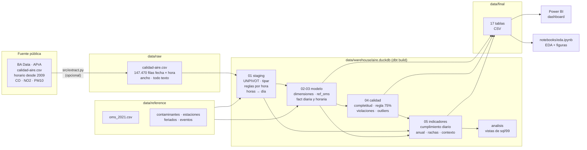

# Flujo ETL

Un solo comando (`python -m src.etl`) recorre el flujo de punta a punta en unos 10 segundos. La descarga del CSV
de BA Data es un paso aparte y opcional (`python -m src.extract`): el CSV crudo ya está en el repo.

## Pasos

| # | Paso | Herramienta | Entrada → salida | Qué hace |
|---|---|---|---|---|
| 0 | **Descarga de la fuente** (opcional) | `src/extract.py` | BA Data → `data/raw/calidad-aire.csv` | Baja el CSV horario con reintentos, verifica que tenga las columnas esperadas y lo guarda tal como viene, sin convertir valores |
| 1 | **Extract** | `src/etl.py` | `data/raw/calidad-aire.csv` | Verifica que esté el crudo; los controles sobre su contenido los hacen los tests de dbt y las consultas A1 a A4 de `sql/99` |
| 2 | **Transform + Load** | dbt (`dbt build`) | raw + reference → DuckDB | Seeds de referencia → staging (UNPIVOT a formato largo, tipos, reglas por hora, valor diario según el promedio de cada contaminante) → dimensiones y facts (grilla completa diaria, NO2 horario, conversión de unidades, outliers) → calidad (completitud, regla del 75%) → indicadores (OMS y contexto 2010-2025). Corre los 89 tests de calidad; si uno de tipo error falla, el ETL se detiene |
| 3 | **Export** | `src/etl.py` | DuckDB → `data/final/` | 17 tablas en CSV (UTF-8, separador `,`, decimal `.`), ordenadas para que dos corridas den archivos idénticos |
| 4 | **Análisis SQL** | `src/etl.py` | `sql/99_consultas_analisis.sql` | Ejecuta las consultas de análisis (verifica que corran) y crea las vistas del schema `analisis` |
| 5 | **Documentar** | `src/diccionario.py` | descripciones de dbt → `docs/diccionario_datos.md` | Genera el diccionario de datos desde los `.yml` de dbt |

Después: `python -m pytest -q` y el notebook (`python -m jupyter nbconvert --to notebook --execute --inplace notebooks/eda.ipynb`, que regenera `reports/figures/`).

## Propiedades

- **Idempotente:** cada corrida reconstruye las tablas desde cero (`materialized: table`) y sobrescribe las
  salidas. Dos corridas seguidas dan exactamente los mismos archivos (lo verifica `test_etl_es_idempotente`).
- **ELT, técnicamente:** el crudo se carga casi sin tocar a la base y se transforma adentro con SQL. Es la forma
  habitual con DuckDB y dbt.
- **Nada se borra:** los valores con problemas se marcan en staging y la fact; el análisis decide qué usar.
- **Rutas relativas:** todo cuelga de la raíz del repo (`src/config.py`); dbt se corre desde `dbt/` y llega a los archivos con `../`.
