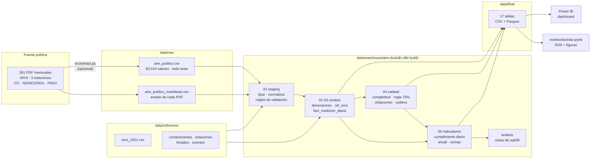

# Flujo ETL

Un solo comando (`make etl` o `python -m src.etl`) recorre el flujo de punta a punta en unos 10 segundos. La
extracción desde los PDF de la APrA es un paso aparte y opcional (`make extract`): el CSV crudo ya está en el repo.

## Pasos

| # | Paso | Herramienta | Entrada → salida | Qué hace |
|---|---|---|---|---|
| 0 | **Extracción de la fuente** (opcional) | `src/extract.py` | PDF de la APrA → `data/raw/aire_publico.csv` | Baja los PDF, reconstruye la tabla diaria por coordenadas y la escribe en formato largo, sin convertir valores. Deja un manifiesto con el estado de cada archivo |
| 1 | **Extract** | `src/etl.py` + `src/calidad.py` | `data/raw/*.csv` | Verifica que esté el crudo y registra filas, columnas, rango de fechas, duplicados, nulos y valores no numéricos |
| 2 | **Transform + Load** | dbt (`dbt build`) | raw + reference → DuckDB | Seeds de referencia → staging (tipos, normalización, reglas físicas) → dimensiones y fact (formato largo, grilla completa, conversión de unidades, outliers) → calidad (completitud, regla del 75%) → indicadores (OMS). Corre los 74 tests de calidad; si uno de tipo error falla, el ETL se detiene |
| 3 | **Export** | `src/etl.py` | DuckDB → `data/final/` | 17 tablas en CSV (UTF-8, separador `,`, decimal `.`) y Parquet, ordenadas para que dos corridas den archivos idénticos |
| 4 | **Análisis SQL** | `src/etl.py` | `sql/99_consultas_analisis.sql` | Ejecuta las consultas de análisis (verifica que corran) y crea las vistas del schema `analisis` |
| 5 | **Documentar** | `src/diccionario.py` | descripciones de dbt → `docs/diccionario_datos.md` | Genera el diccionario de datos desde los `.yml` de dbt |

Después: `make test` (pytest) y `make eda` (ejecuta el notebook y regenera `reports/figures/`).

## Propiedades

- **Idempotente:** cada corrida reconstruye las tablas desde cero (`materialized: table`) y sobrescribe las
  salidas. Dos corridas seguidas dan exactamente los mismos archivos (lo verifica `test_etl_es_idempotente`).
- **ELT, técnicamente:** el crudo se carga casi sin tocar a la base y se transforma adentro con SQL. Es la forma
  habitual con DuckDB y dbt.
- **Nada se borra:** los valores con problemas se marcan en staging y la fact; el análisis decide qué usar.
- **Rutas relativas:** todo cuelga de la raíz del repo (`src/config.py` y la variable `AIRE_RAIZ` que usa dbt).
