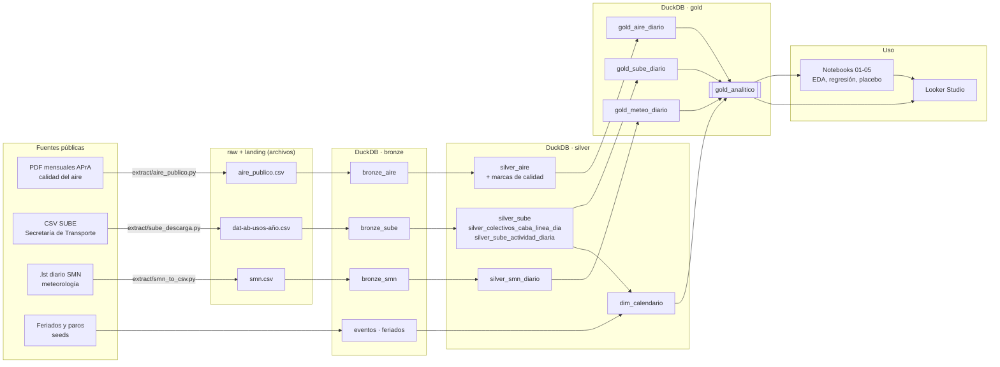
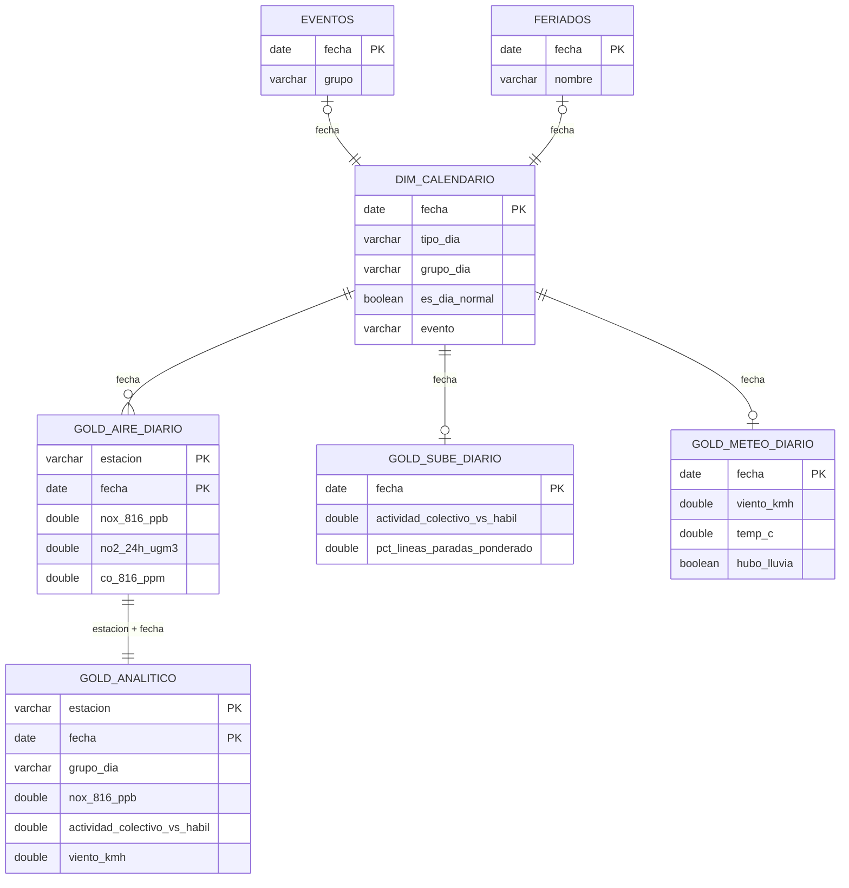

# Modelo de datos y diccionario

Cómo se guardan y se relacionan los datos del TP, por qué se modelaron así y qué significa cada columna.

- **Base:** un archivo DuckDB, `data/nox.duckdb`, con tres esquemas: `bronze`, `silver` y `gold`.
- **Transformaciones:** 14 modelos de dbt (SQL) y 2 tablas de referencia versionadas (*seeds*).
- **Calidad:** 44 tests de dbt que corren en cada `dbt build`.
- **Salida:** las tablas de gold se exportan a `export/` (Parquet para los notebooks, CSV para Looker Studio).

## 1. Arquitectura: del dato crudo al dashboard

Arquitectura **medallón**: cada capa tiene una sola responsabilidad y nunca se modifica la anterior.

| Capa | Dónde | Qué tiene | Regla |
|---|---|---|---|
| **raw** | `data/raw/` | Archivos tal como se descargan (PDF, CSV, `.lst`) | Inmutable: nunca se edita |
| **landing** | `data/landing/` | Los PDF y el `.lst` pasados a CSV en formato largo | Solo cambia el formato, no los valores |
| **bronze** | esquema `bronze` | Landing cargado en la base, **todo como texto**, con archivo de origen y fecha de carga | Copia fiel: si algo está mal, se ve acá |
| **silver** | esquema `silver` | Tipado (fechas, números), normalizado y con **marcas de calidad** | No se borran filas: se marcan |
| **gold** | esquema `gold` | Tablas listas para analizar, una fila por estación y día | Solo entran valores válidos |

## 2. Modelo de la capa gold

La tabla del análisis es **`gold_analitico`**: una fila por **estación de monitoreo y día** (2.950 filas, 3
estaciones de enero de 2024 a septiembre de 2026). Se arma uniendo las otras tablas gold por la fecha:

**Claves y relaciones:**
- `dim_calendario` es la **dimensión compartida**: un registro por día de 2024 a 2026. Ahí se resuelve, una sola vez,
  qué tipo de día es (hábil, sábado, domingo, feriado), si es un día normal y si hubo paro (`grupo_dia`). Todas las
  tablas usan esa misma definición.
- `gold_aire_diario` tiene clave **(estación, fecha)**. Las tablas de transporte y meteorología tienen clave
  **fecha**, porque son valores de toda la Ciudad (la SUBE no se puede asignar a una estación de monitoreo y el SMN
  tiene dos estaciones que se promedian).
- `gold_analitico` toma `gold_aire_diario` y le agrega por fecha el calendario, la SUBE y la meteorología. Es una
  tabla ancha y desnormalizada a propósito: los notebooks y el dashboard leen de un solo lugar, sin joins.
- Los tests `gold_analitico_clave_unica` y `gold_aire_clave_unica` verifican que los joins no dupliquen filas.

## 3. Decisiones de modelado (y por qué)

| Decisión | Por qué |
|---|---|
| **Medallón (bronze → silver → gold)** | Separa "cargar" de "limpiar" de "analizar". Si un número de gold parece raro, se puede seguir hacia atrás hasta el PDF de origen (`archivo_pdf`). |
| **DuckDB en un solo archivo** | Base analítica sin servidor: se copia como un archivo, la leen Python, DBeaver y la CLI. El volumen (1,5 millones de filas de SUBE) entra cómodo. Fijada en la versión 1.x porque la 2.0 cambió el formato de archivo. |
| **dbt para las transformaciones** | Todo el SQL versionado, con dependencias explícitas (el linaje se ve con `dbt docs`) y tests que corren solos. |
| **Bronze todo como texto** | Los PDF traen valores como `s/d`, `DND` o `<4`. Si se convirtieran a número al cargar, se perderían sin aviso. |
| **No borrar filas en silver, marcarlas** | Cada problema queda visible y contado (ver `analysis/consultas.sql`, consulta 7). Gold elige qué usar. |
| **Grano estación × día** | Es el grano más fino publicado por la APrA (tabla diaria del PDF). La SUBE y el SMN también son diarios. |
| **Bloque de 8 a 16 h** | Es la ventana diurna que publica la APrA, cuando circulan los colectivos. El promedio de 24 h se guarda para la OMS y como verificación. |
| **NO2 también en µg/m³** | Las guías de la OMS están en µg/m³ y la APrA publica en ppb. La conversión (1,88 a 25 °C) se hace una vez, en SQL. |
| **Clave de línea = número** | El nombre de una misma línea cambia entre archivos y años (`LINEA 12`, `CABA_LINEA_12`, `BSAS_LINEA_026`…). El número es lo único estable. |
| **Dimensión calendario con `grupo_dia`** | Un único criterio de "qué tipo de día es" para todo el TP: notebooks y dashboard no pueden contradecirse. |
| **Tablas planas para Looker Studio** | Looker no hace bien los joins: `run.py` le entrega una tabla por gráfico, ya unida, en CSV UTF-8. |

## 4. Diccionario de datos

Generado con `uv run python docs/generar_diccionario.py`: los tipos salen de la base y las descripciones, de los
`.yml` de dbt (las mismas que muestra `dbt docs`). La capa bronze no se detalla porque replica las fuentes como
texto (ver `docs/proceso.md`).

<!-- diccionario:inicio -->
### `gold.gold_analitico` (2.950 filas)

Tabla del análisis: una fila por estación de monitoreo y día, con calidad del aire, actividad del transporte, dosis de paro, meteorología, tipo de día, marca de día normal y evento.

| Columna | Tipo | Descripción |
|---|---|---|
| `estacion` | VARCHAR | Estación de monitoreo de la APrA: CENTENARIO, CORDOBA o LA BOCA. |
| `fecha` | DATE | Día (fecha local de Buenos Aires). |
| `anio` | BIGINT | Año de la fecha. |
| `mes` | BIGINT | Mes de la fecha (1-12). |
| `dia_semana` | BIGINT | Día de la semana ISO: 1 = lunes ... 7 = domingo. |
| `nombre_dia` | VARCHAR | Nombre del día de la semana. |
| `tipo_dia` | VARCHAR | hábil, sábado, domingo o feriado (feriados del seed `feriados`). |
| `grupo_dia` | VARCHAR | Grupo de día: Hábil normal, Hábil baja actividad, Sábado, Domingo, Feriado, Paro de colectivos o Paro de trenes o subte (de dim_calendario). |
| `feriado` | VARCHAR | Nombre del feriado, si lo es. |
| `es_dia_normal` | BOOLEAN | Hábil, no feriado y con actividad de transporte típica. Universo de la regresión. |
| `evento` | VARCHAR | Nombre del paro, si ese día hubo uno del estudio. |
| `grupo_evento` | VARCHAR | sin_colectivos (paro de colectivos) o trenes_subte (paro de trenes o subte con colectivos funcionando). |
| `no_816_ppb` | DOUBLE | NO, promedio del bloque de 8 a 16 h (ppb). |
| `no2_816_ppb` | DOUBLE | NO2, promedio del bloque de 8 a 16 h (ppb). |
| `nox_816_ppb` | DOUBLE | NOx, promedio del bloque de 8 a 16 h (ppb). Variable de las hipótesis. |
| `co_816_ppm` | DOUBLE | CO, promedio del bloque de 8 a 16 h (ppm). |
| `pm10_816_ugm3` | DOUBLE | PM10, promedio del bloque de 8 a 16 h (µg/m³). |
| `nox_co_816` | DOUBLE | NOx (ppb) / CO (ppm) del bloque 8-16 h: NOx relativo al CO. Verificación de mecanismo. |
| `no2_24h_ppb` | DOUBLE | NO2, promedio de 24 h (ppb). |
| `no2_24h_ugm3` | DOUBLE | NO2, promedio de 24 h en µg/m³ (1,88 µg/m³ por ppb a 25 °C). Se compara con la guía OMS (25). |
| `nox_24h_ppb` | DOUBLE | NOx, promedio de 24 h (ppb). |
| `co_24h_ppm` | DOUBLE | CO, promedio de 24 h (ppm). |
| `pm10_24h_ugm3` | DOUBLE | PM10, promedio de 24 h (µg/m³). Guía OMS de 24 h: 45. |
| `actividad_colectivo_vs_habil` | DOUBLE | Viajes de colectivos de CABA / un día hábil normal típico (±4 semanas). 1 = hábil normal, ≈0,35 = domingo. |
| `ratio_colectivo_caba` | DOUBLE | Viajes del universo CABA / su base habitual (solo días con base, de lunes a viernes). |
| `ratio_colectivo` | DOUBLE | Viajes en colectivo / mediana del mismo día de la semana en días normales (±4 semanas). |
| `ratio_tren` | DOUBLE | Viajes en tren / mediana del mismo día de la semana en días normales (±4 semanas). |
| `ratio_subte` | DOUBLE | Viajes en subte / mediana del mismo día de la semana en días normales (±4 semanas). |
| `pct_lineas_paradas_ponderado` | DOUBLE | % de líneas paradas ponderado por sus viajes habituales: la dosis del paro. Vacío los fines de semana. |
| `viento_kmh` | DOUBLE | Velocidad media diaria del viento (km/h), promedio de Aeroparque y Observatorio (SMN). |
| `viento_max_kmh` | DOUBLE | Ráfaga máxima del día (km/h), máximo de las dos estaciones. |
| `temp_c` | DOUBLE | Temperatura media diaria (°C), promedio de las dos estaciones. |
| `humedad_pct` | DOUBLE | Humedad relativa media diaria (%). |
| `precipitacion_mm` | DOUBLE | Lluvia diaria (mm), máximo de las dos estaciones. Sin registro = 0 (supuesto declarado). |
| `hubo_lluvia` | BOOLEAN | Lluvia de 1 mm o más. |

### `gold.gold_aire_diario` (2.950 filas)

Tabla analítica de calidad del aire: una fila por estación y día. Ventana diurna = bloque de 8 a 16 h. Incluye el cociente NOx/CO (firma diésel) y los promedios de 24 h para comparar con las guías OMS. Solo usa valores válidos y dentro de rango.

| Columna | Tipo | Descripción |
|---|---|---|
| `estacion` | VARCHAR | Estación de monitoreo de la APrA: CENTENARIO, CORDOBA o LA BOCA. |
| `fecha` | DATE | Día (fecha local de Buenos Aires). |
| `tipo_dia` | VARCHAR | hábil, sábado, domingo o feriado (feriados del seed `feriados`). |
| `nombre_dia` | VARCHAR | Nombre del día de la semana. |
| `feriado` | VARCHAR | Nombre del feriado, si lo es. |
| `evento` | VARCHAR | Nombre del paro, si ese día hubo uno del estudio. |
| `grupo_evento` | VARCHAR | sin_colectivos (paro de colectivos) o trenes_subte (paro de trenes o subte con colectivos funcionando). |
| `no_816_ppb` | DOUBLE | NO, promedio del bloque de 8 a 16 h (ppb). |
| `no2_816_ppb` | DOUBLE | NO2, promedio del bloque de 8 a 16 h (ppb). |
| `nox_816_ppb` | DOUBLE | NOx, promedio del bloque de 8 a 16 h (ppb). Variable de las hipótesis. |
| `co_816_ppm` | DOUBLE | CO, promedio del bloque de 8 a 16 h (ppm). |
| `pm10_816_ugm3` | DOUBLE | PM10, promedio del bloque de 8 a 16 h (µg/m³). |
| `nox_co_816` | DOUBLE | NOx (ppb) / CO (ppm) del bloque de 8 a 16 h. |
| `no2_24h_ppb` | DOUBLE | NO2, promedio de 24 h (ppb). |
| `no2_24h_ugm3` | DOUBLE | NO2 de 24 h en µg/m³ (guía OMS 24 h = 25 µg/m³). |
| `nox_24h_ppb` | DOUBLE | NOx, promedio de 24 h (ppb). |
| `co_24h_ppm` | DOUBLE | CO, promedio de 24 h (ppm). |
| `pm10_24h_ugm3` | DOUBLE | PM10 de 24 h en µg/m³ (guía OMS 24 h = 45 µg/m³). |

### `gold.gold_sube_diario` (1.029 filas)

Un registro por día: usos y proporción de un día típico por modo, y la "dosis" de paro de colectivos (porcentaje de líneas que circulan por CABA con menos del 15% de sus usos habituales).

| Columna | Tipo | Descripción |
|---|---|---|
| `fecha` | DATE | Día (fecha local de Buenos Aires). |
| `es_dia_normal` | BOOLEAN | Hábil, no feriado y con colectivo, tren y subte por encima del 90% de su uso habitual. Es la base del modelo de referencia. |
| `usos_colectivo` | BIGINT | Viajes en colectivo de todo el AMBA ese día (SUBE). |
| `usos_tren` | BIGINT | Viajes en tren del AMBA ese día (SUBE). |
| `usos_subte` | BIGINT | Viajes en subte ese día (SUBE). |
| `usos_colectivo_caba` | BIGINT | Viajes en las 134 líneas de colectivo que circulan por CABA. |
| `ratio_colectivo` | DOUBLE | Viajes en colectivo / mediana del mismo día de la semana en días normales (±4 semanas). |
| `ratio_tren` | DOUBLE | Viajes en tren / mediana del mismo día de la semana en días normales (±4 semanas). |
| `ratio_subte` | DOUBLE | Viajes en subte / mediana del mismo día de la semana en días normales (±4 semanas). |
| `ratio_colectivo_caba` | DOUBLE | Usos del universo CABA / usos habituales del mismo día de la semana (solo días hábiles, porque la base son días normales). Mide cuánto se apartó un día hábil de lo habitual. |
| `actividad_colectivo_vs_habil` | DOUBLE | Usos de colectivos de CABA / un día hábil normal típico (±4 semanas). Comparable entre tipos de día (domingo ~0,4; paro ~0,1). Eje X del gráfico de actividad vs. NOx/CO. |
| `lineas_evaluadas` | BIGINT | Líneas con base suficiente (> 2.000 viajes) para calcular si pararon. |
| `pct_lineas_paradas` | DOUBLE | % de líneas paradas (menos del 15% de sus viajes habituales), sin ponderar. Vacío los fines de semana. |
| `pct_lineas_paradas_ponderado` | DOUBLE | Porcentaje de líneas paradas, ponderado por sus usos habituales. Es la dosis del evento. Nulo en sábados y domingos (no hay base de comparación). |
| `pct_paradas_solo_caba` | DOUBLE | Dosis entre las líneas que circulan solo dentro de CABA. |
| `pct_paradas_interjurisdiccionales` | DOUBLE | Dosis entre las líneas nacionales (cruzan CABA y provincia). |

### `gold.gold_meteo_diario` (943 filas)

Meteorología de cada día (valor de ciudad), solo del registro diario del SMN (Aeroparque y Observatorio Central). Viento, temperatura y humedad: promedio de las dos estaciones. Lluvia: máximo diario entre las dos; sin registro = sin lluvia (supuesto a declarar). Llega hasta el último día con datos del SMN.

| Columna | Tipo | Descripción |
|---|---|---|
| `fecha` | DATE | Día (fecha local de Buenos Aires). |
| `viento_kmh` | DOUBLE | Velocidad media diaria del viento (km/h), promedio de las dos estaciones. |
| `viento_max_kmh` | DOUBLE | Ráfaga máxima del día (km/h), máximo de las dos estaciones. |
| `temp_c` | DOUBLE | Temperatura media diaria (°C), promedio de las dos estaciones. |
| `humedad_pct` | DOUBLE | Humedad relativa media diaria (%). |
| `estaciones_con_viento` | BIGINT | Cantidad de estaciones del SMN con dato de viento ese día. |
| `precipitacion_mm` | DOUBLE | Lluvia diaria (mm), máximo de las dos estaciones. Sin registro = 0 (supuesto declarado). |
| `precipitacion_sin_registro` | BOOLEAN | Ninguna de las dos estaciones informó lluvia ese día. |
| `hubo_lluvia` | BOOLEAN | Precipitación de 1 mm o más en alguna de las dos estaciones. |

### `silver.dim_calendario` (1.096 filas)

Un registro por día de 2024 a 2026: día de la semana, tipo de día (hábil, sábado, domingo, feriado) y evento de paro si lo hubo.

| Columna | Tipo | Descripción |
|---|---|---|
| `fecha` | DATE | Día (fecha local de Buenos Aires). |
| `anio` | BIGINT | Año de la fecha. |
| `mes` | BIGINT | Mes de la fecha (1-12). |
| `dia_semana` | BIGINT | Día de la semana ISO: 1 = lunes ... 7 = domingo. |
| `nombre_dia` | VARCHAR | Nombre del día de la semana. |
| `feriado` | VARCHAR | Nombre del feriado, si lo es. |
| `tipo_dia` | VARCHAR | hábil, sábado, domingo o feriado (feriados del seed `feriados`). |
| `es_dia_normal` | BOOLEAN | Hábil, no feriado y con colectivo, tren y subte por encima del 90% de su uso habitual. Es la base del modelo de referencia. |
| `grupo_dia` | VARCHAR | Grupo para comparar días: Hábil normal (la referencia), Hábil baja actividad (hábil con colectivo, tren o subte por debajo del 90% de lo habitual: vacaciones, fiestas, problemas en trenes o subte), Sábado, Domingo, Feriado, Paro de colectivos y Paro de trenes o subte (con colectivos funcionando). |
| `evento` | VARCHAR | Nombre del paro, si ese día hubo uno del estudio. |
| `grupo_evento` | VARCHAR | sin_colectivos (paro de colectivos) o trenes_subte (paro de trenes o subte con colectivos funcionando). |
| `pct_lineas_paradas_caba` | INTEGER | % de líneas de colectivo paradas según el seed de eventos (valor de referencia). |

### `silver.silver_aire` (83.010 filas)

Calidad del aire tipada. Cada valor tiene un estado (valido, sin_dato, bajo_limite_deteccion, invalido) y una marca de rango físico. No se eliminan filas. Grano: estación × fecha × contaminante × estadístico.

| Columna | Tipo | Descripción |
|---|---|---|
| `estacion` | VARCHAR | Estación de monitoreo de la APrA: CENTENARIO, CORDOBA o LA BOCA. |
| `fecha` | DATE | Día (fecha local de Buenos Aires). |
| `contaminante` | VARCHAR | NO, NO2, NOx, CO o PM10. |
| `estadistico` | VARCHAR | 24h, 0-8, 8-16, 16-24 (promedios) o max_1h, min_1h (extremos horarios del día). |
| `valor_crudo` | VARCHAR | Valor tal como aparece en el PDF (texto, con coma decimal o 's/d', 'DND', '<4'). |
| `estado_valor` | VARCHAR | valido / sin_dato ("s/d", "DND") / bajo_limite_deteccion ("<4") / invalido (texto no numérico). |
| `valor` | DOUBLE | Valor numérico en la unidad original; nulo si el estado no es 'valido'. |
| `unidad_original` | VARCHAR | Unidad del PDF: ppb (NO, NO2, NOx), ppm (CO) o µg/m³ (PM10). |
| `limite_deteccion` | DOUBLE | Para los valores "<4", el límite de detección (4). |
| `fuera_de_rango` | BOOLEAN | Negativo o por encima de un máximo físicamente posible para el contaminante. |
| `nox_incoherente` | BOOLEAN | En NO, NO2 y NOx: el mismo día y bloque no cumple NOx = NO + NO2 (tolerancia 2 ppb). Se marcan los tres porque no se puede saber cuál está mal. |
| `fuera_de_max_min` | BOOLEAN | El promedio (24 h o bloque de 8 h) cae fuera del mínimo y máximo horario del día. |
| `cero_sin_respaldo` | BOOLEAN | Promedio en 0 cuando el máximo horario del día es 0 o falta: celda vacía de la planilla o analizador caído. No es una medición real y no entra a gold. |
| `valor_masa` | DOUBLE | Concentración en masa (µg/m³, o mg/m³ para CO), para comparar con guías OMS. |
| `unidad_masa` | VARCHAR | Unidad de valor_masa: µg/m³ o mg/m³ (CO). |
| `archivo_pdf` | VARCHAR | PDF de la APrA del que salió el valor (trazabilidad). |

### `silver.silver_sube` (1.536.620 filas)

SUBE tipado (grano: fecha × empresa × etiqueta de línea × modo). Agrega `linea_num` (número de línea normalizado), `es_colectivo_caba` (universo de análisis: 134 líneas que circulan por CABA) y `es_linea_solo_caba` (las 31 líneas traspasadas a la Ciudad en enero de 2025).

| Columna | Tipo | Descripción |
|---|---|---|
| `fecha` | DATE | Día (fecha local de Buenos Aires). |
| `empresa` | VARCHAR | Empresa operadora. |
| `linea_original` | VARCHAR | Nombre de la línea tal como viene en el archivo. |
| `linea_num` | INTEGER | Número de línea (clave normalizada: se extrae del nombre, que cambia entre archivos). |
| `es_amba` | BOOLEAN | La línea pertenece al AMBA. |
| `tipo_transporte` | VARCHAR | COLECTIVO, TREN, SUBTE, etc. |
| `jurisdiccion` | VARCHAR | Jurisdicción de la línea (NACIONAL, C.A.B.A, PROVINCIAL, MUNICIPAL). |
| `provincia` | VARCHAR | Provincia declarada en el archivo. |
| `municipio` | VARCHAR | Municipio declarado en el archivo. |
| `usos` | BIGINT | Transacciones SUBE (validaciones) del día. |
| `es_dato_preliminar` | BOOLEAN | El dato está marcado como preliminar por la fuente (desde 2026). |
| `es_colectivo_caba` | BOOLEAN | La fila pertenece al universo de colectivos que circulan por CABA. |
| `es_linea_solo_caba` | BOOLEAN | La línea circula solo dentro de CABA (pasó a jurisdicción de la Ciudad en 2025). |

### `silver.silver_colectivos_caba_linea_dia` (135.219 filas)

Usos por línea (número normalizado) y día, sumando etiquetas y operadores de la misma línea.

| Columna | Tipo | Descripción |
|---|---|---|
| `fecha` | DATE | Día (fecha local de Buenos Aires). |
| `linea_num` | INTEGER | Número de línea (clave normalizada: se extrae del nombre, que cambia entre archivos). |
| `es_linea_solo_caba` | BOOLEAN | La línea circula solo dentro de CABA (pasó a jurisdicción de la Ciudad en 2025). |
| `usos` | BIGINT | Cantidad de viajes pagados con SUBE. |
| `etiquetas` | VARCHAR | Nombres originales de la línea ese día (pueden ser varios). |

### `silver.silver_sube_actividad_diaria` (1.029 filas)

Actividad diaria por modo en el AMBA, como proporción de un día típico (mediana del mismo día de la semana, ±4 semanas). Define `es_dia_normal`: hábil, no feriado y colectivo, tren y subte > 90%.

| Columna | Tipo | Descripción |
|---|---|---|
| `fecha` | DATE | Día (fecha local de Buenos Aires). |
| `usos_colectivo` | BIGINT | Viajes en colectivo de todo el AMBA ese día (SUBE). |
| `usos_tren` | BIGINT | Viajes en tren del AMBA ese día (SUBE). |
| `usos_subte` | BIGINT | Viajes en subte ese día (SUBE). |
| `usos_colectivo_caba` | BIGINT | Viajes en las 134 líneas de colectivo que circulan por CABA. |
| `ratio_colectivo` | DOUBLE | Viajes en colectivo / mediana del mismo día de la semana en días normales (±4 semanas). |
| `ratio_tren` | DOUBLE | Viajes en tren / mediana del mismo día de la semana en días normales (±4 semanas). |
| `ratio_subte` | DOUBLE | Viajes en subte / mediana del mismo día de la semana en días normales (±4 semanas). |
| `es_dia_normal` | BOOLEAN | Hábil, no feriado y con colectivo, tren y subte por encima del 90% de su uso habitual. Es la base del modelo de referencia. |

### `silver.silver_smn_diario` (4.076 filas)

| Columna | Tipo | Descripción |
|---|---|---|
| `estacion` | VARCHAR | Estación de monitoreo de la APrA: CENTENARIO, CORDOBA o LA BOCA. |
| `fecha` | DATE | Día (fecha local de Buenos Aires). |
| `temp_media_c` | DOUBLE | Temperatura media (°C). |
| `temp_max_c` | DOUBLE | Temperatura máxima (°C). |
| `temp_min_c` | DOUBLE | Temperatura mínima (°C). |
| `humedad_pct` | DOUBLE | Humedad relativa media diaria (%). |
| `presion_hpa` | DOUBLE | Presión a nivel de la estación (hPa). |
| `viento_medio_kmh` | DOUBLE | Velocidad media del viento (km/h). |
| `viento_max_kmh` | DOUBLE | Ráfaga máxima del día (km/h), máximo de las dos estaciones. |
| `viento_max_dir_grados` | DOUBLE | Dirección de la ráfaga máxima (grados; viene en decenas de grado). |
| `nubosidad_octavos` | DOUBLE | Nubosidad total (octavos). |
| `heliofania_h` | DOUBLE | Horas de sol. |
| `precipitacion_mm` | DOUBLE | Lluvia diaria (mm), máximo de las dos estaciones. Sin registro = 0 (supuesto declarado). |

### `bronze.eventos` (7 filas)

Los días de paro de transporte público de 2024-2026 confirmados en los datos de SUBE, en dos grupos: sin_colectivos (paró más de la mitad de las líneas de colectivo) y trenes_subte (pararon trenes y/o subte con los colectivos funcionando). Incluye el % de líneas de colectivo que circulan por CABA que pararon.

| Columna | Tipo | Descripción |
|---|---|---|
| `fecha` | DATE | Día (fecha local de Buenos Aires). |
| `evento` | VARCHAR | Nombre del paro, si ese día hubo uno del estudio. |
| `grupo` | VARCHAR | sin_colectivos o trenes_subte. |
| `pct_lineas_paradas_caba` | INTEGER | % de líneas de colectivo paradas según el seed de eventos (valor de referencia). |
| `fuente_prensa` | VARCHAR | Nota periodística que confirma el paro. |

### `bronze.feriados` (59 filas)

Feriados nacionales 2024-2026, incluidos los puentes turísticos. Fuente: API pública ArgentinaDatos (https://api.argentinadatos.com/v1/feriados/<año>). No incluye días no laborables optativos (p. ej. Jueves Santo): esos días los detecta SUBE.

| Columna | Tipo | Descripción |
|---|---|---|
| `fecha` | DATE | Día (fecha local de Buenos Aires). |
| `tipo` | VARCHAR | inamovible, trasladable o puente. |
| `nombre` | VARCHAR | Nombre del feriado. |

<!-- diccionario:fin -->
