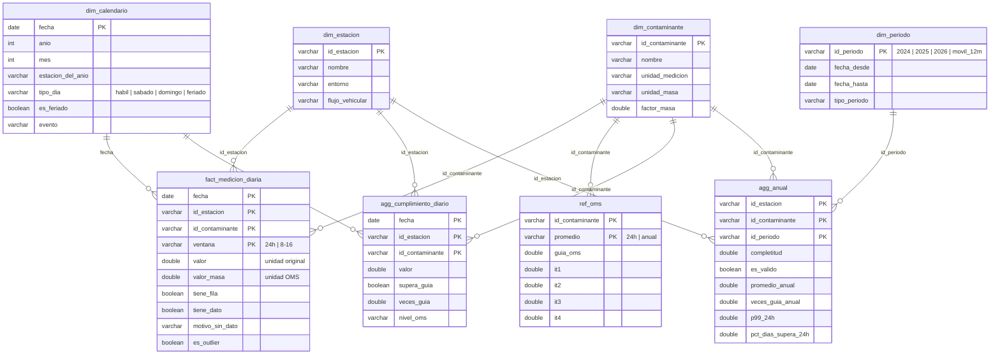

# Modelo de datos

Cómo están organizados los datos para poder consultarlos: una base **DuckDB** (`data/warehouse/aire.duckdb`)
construida con **dbt**, con un **esquema estrella** en el centro. El detalle de cada columna está en
[`diccionario_datos.md`](diccionario_datos.md).

## 1. Capas (schemas)

| Schema | Qué tiene | Modelos dbt |
|---|---|---|
| `referencia` | Tablas mantenidas a mano en `data/reference/` (seeds) | `oms_2021`, `contaminantes`, `estaciones`, `feriados`, `eventos` |
| `staging` | El crudo tipado y validado, una fila por celda de los PDF | `stg_aire`, `stg_aire_validado`, `stg_manifiesto` |
| `modelo` | **Esquema estrella**: dimensiones, referencias OMS y la tabla de hechos | `dim_*`, `ref_oms`, `ref_oms_niveles`, `fact_medicion_diaria` |
| `calidad` | Completitud, violaciones a las reglas, outliers y estado de los PDF | `agg_completitud_*`, `calidad_*` |
| `indicadores` | Los indicadores contra la OMS | `agg_cumplimiento_diario`, `agg_anual`, `agg_rachas` |
| `analisis` | Vistas de `sql/99_consultas_analisis.sql` (para verificar el dashboard) | `v_resumen_estacion`, `v_cumplimiento_por_tipo_dia`, `v_indicadores_excluidos` |

## 2. Esquema estrella

| Tabla | Qué representa | Clave | Filas |
|---|---|---|---|
| `fact_medicion_diaria` | Una medición diaria: un contaminante, en una estación, un día, en una ventana | `fecha, id_estacion, id_contaminante, ventana` | 30.120 |
| `dim_calendario` | Un día del período, haya o no datos (tipo de día, feriado, estación del año, evento) | `fecha` | 1.004 |
| `dim_estacion` | Una estación de monitoreo (ubicación, entorno, flujo vehicular) | `id_estacion` | 3 |
| `dim_contaminante` | Un contaminante (unidades, factor de conversión, tolerancias) | `id_contaminante` | 5 |
| `ref_oms` | Una guía OMS: contaminante × período de promedio, con objetivos intermedios | `id_contaminante, promedio` | 5 |
| `ref_oms_niveles` | La misma guía en formato largo, una fila por nivel (para líneas de referencia) | `id_contaminante, promedio, nivel` | 19 |
| `dim_periodo` | Un período de indicadores anuales | `id_periodo` | 4 |
| `agg_cumplimiento_diario` | Un día con dato de NO2, PM10 o CO comparado con su guía de 24 h | `fecha, id_estacion, id_contaminante` | 7.823 |
| `agg_anual` | Indicadores de un período por estación y contaminante | `id_estacion, id_contaminante, id_periodo` | 36 |

**Relaciones:** todas son uno a muchos desde la dimensión hacia la tabla de hechos o el agregado. Los tests de dbt
`relationships` verifican que toda clave de la fact exista en su dimensión (integridad referencial).

## 3. Decisiones de modelado

### Formato largo y no ancho

El crudo y la tabla diaria del proyecto anterior tenían **una columna por contaminante y ventana**
(`no2_24h_ppb`, `pm10_816_ugm3`, etc.). Se eligió el formato **largo** (una fila por contaminante) porque:

- **El JOIN con la OMS es por contaminante:** `fact JOIN ref_oms USING (id_contaminante)` resuelve todos los
  contaminantes con la misma consulta. En formato ancho habría que escribir una comparación por columna.
- **En Power BI** un solo segmentador elige el contaminante y todas las medidas DAX sirven para todos.
- **Agregar un contaminante** (por ejemplo, O3) no cambia la estructura de ninguna tabla.
- Es la forma estándar de una tabla de hechos en un esquema estrella.

**Alternativa (formato ancho):** es más cómoda para correlaciones y gráficos de dispersión entre contaminantes (una
fila por estación y día). Cuando hace falta, se pivotea en el momento (el notebook lo hace en la sección 9).

### Grilla completa

La fact tiene todas las combinaciones calendario × estación × contaminante × ventana, aunque no haya dato. Así:
los días faltantes se cuentan con un `COUNT` (no hay que "buscar lo que no está"), la completitud es un promedio
de `tiene_dato` y Power BI puede mostrar huecos en las series. El costo es tener filas con valor nulo (15% de la
fact), marcadas con `tiene_dato = false` y su motivo.

### Dos ventanas: 24 h y 8 a 16 h

La OMS define sus guías sobre el **promedio de 24 h**: todos los indicadores usan esa ventana. La ventana de **8 a
16 h** (horario de actividad, la que publica la APrA) queda en la fact como contexto para el análisis por tipo de
día y ritmo semanal.

### Umbrales en tablas, no en el código

Las guías OMS (`ref_oms`), las tolerancias de las reglas de calidad y los factores de conversión
(`dim_contaminante`) y los parámetros del estudio (período, regla del 75%, factor del IQR, en `dbt_project.yml`)
están en tablas o variables. El SQL los trae con un JOIN o con `var()`: cambiar un umbral no obliga a tocar
consultas.

### Valores en dos unidades

`valor` (unidad publicada: ppb, ppm, µg/m³) sirve para las reglas de calidad y para comparar con la fuente;
`valor_masa` (unidad de la OMS: µg/m³; mg/m³ para el CO) sirve para los indicadores.

### Por qué DuckDB y dbt

- **DuckDB:** base analítica en un solo archivo, sin servidor, que lee CSV directamente y usa SQL
  estándar. Si la cátedra pide otro motor, el SQL se porta casi entero; las funciones propias de DuckDB están
  comentadas donde aparecen (`FILTER`, `quantile_cont`, `UNPIVOT`, `generate_series`, fecha − entero).
- **dbt:** cada tabla es un `SELECT` en un archivo `.sql`. dbt las ejecuta en orden de dependencias (`ref()`),
  corre los tests de calidad en cada build y genera la documentación con el linaje de las tablas (`dbt docs`).
  No agrega infraestructura: es una librería de Python que corre contra el mismo archivo DuckDB.

## 4. Vistas para Power BI

Power BI importa los CSV de `data/final/` (no se conecta a la base). Las vistas del schema `analisis`
(`sql/99_consultas_analisis.sql`, parte D) calculan en SQL lo mismo que las medidas DAX del
modelo de Power BI y sirven para verificar que el dashboard muestre los números correctos.
