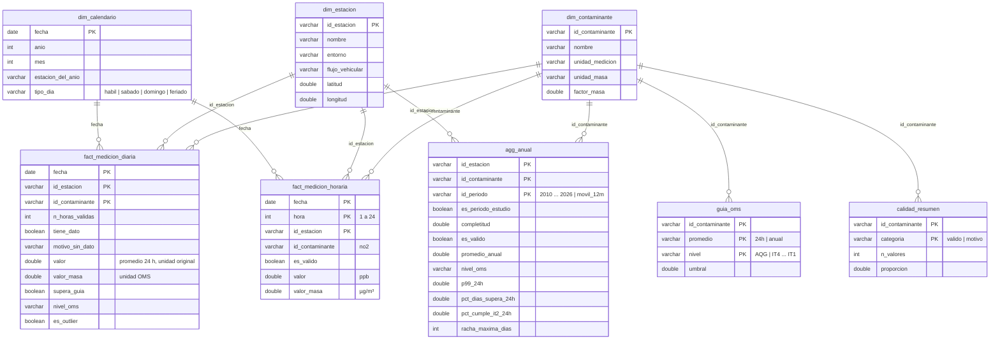

# Modelo de datos

Cómo están organizados los datos para poder consultarlos: una base **DuckDB** (`data/warehouse/aire.duckdb`)
construida con **dbt** en **arquitectura medallón** (bronze → silver → gold), con un **esquema estrella** en la
capa gold. El detalle de cada columna está en [`diccionario_datos.md`](diccionario_datos.md).

## 1. Capas: bronze, silver y gold

Cada capa es un schema de la base y una carpeta de `dbt/models/`. Los datos solo van hacia adelante: bronze no
sabe nada de silver, y gold se arma solo con silver y las referencias.

| Capa | Qué tiene | Tablas | Filas |
|---|---|---|---|
| **bronze** | El dato tal como llega: el CSV de BA Data sin tocar (todo texto, formato ancho) y las tablas de referencia mantenidas a mano en `data/reference/` (seeds) | `calidad_aire`, `oms_2021`, `contaminantes`, `estaciones`, `feriados` | 147.470 (el CSV) |
| **silver** | El dato limpio y en formato largo: valores horarios tipados con las reglas de calidad aplicadas (nada se borra: se marca) y el valor diario de cada contaminante. Toda la serie, desde 2009 | `medicion_horaria`, `medicion_diaria` | 1.327.230 y 55.872 |
| **gold** | Lo que se analiza y se muestra: el esquema estrella del período de estudio, las guías OMS y los indicadores. Es lo único que se exporta a `data/final/` | 3 dimensiones, `guia_oms`, 2 tablas de hechos, `agg_anual`, `calidad_resumen` | ver abajo |

Por qué tres capas y no una sola consulta enorme: cada paso se puede revisar por separado. Si un número de gold
sorprende, se mira el valor diario en silver; si el valor diario sorprende, se miran las horas en silver y el texto
original en bronze. Y un test de dbt verifica que no se pierde nada en el camino: silver tiene exactamente 9 filas
por cada fila del CSV (3 estaciones × 3 contaminantes).

El recorrido completo, con cada paso, está en [`diagrama_etl.md`](diagrama_etl.md).

## 2. Esquema estrella (gold)

| Tabla | Qué representa | Clave | Filas |
|---|---|---|---|
| `fact_medicion_diaria` | El promedio de 24 h de un contaminante, en una estación, un día, comparado con la guía de 24 h | `fecha, id_estacion, id_contaminante` | 9.036 |
| `fact_medicion_horaria` | Una hora de NO2 en una estación (segunda tabla de hechos, otro grano) | `fecha, hora, id_estacion` | 70.704 |
| `dim_calendario` | Un día del período, haya o no datos (tipo de día, feriado, estación del año) | `fecha` | 1.004 |
| `dim_estacion` | Una estación de monitoreo (ubicación, entorno, flujo vehicular) | `id_estacion` | 3 |
| `dim_contaminante` | Un contaminante (unidades, factor de conversión, cómo lo publica la red, máximo plausible) | `id_contaminante` | 3 |
| `guia_oms` | Un escalón de la OMS 2021: contaminante × período de promedio × nivel (guía u objetivo intermedio) | `id_contaminante, promedio, nivel` | 19 |
| `agg_anual` | Indicadores de un período (año 2010-2026 o últimos 12 meses) por estación y contaminante | `id_estacion, id_contaminante, id_periodo` | 162 |
| `calidad_resumen` | Qué pasó con los valores horarios del período: válidos o descartados, y por qué regla | `id_contaminante, categoria` | 17 |

**Relaciones:** todas son uno a muchos desde la dimensión hacia la tabla de hechos o el agregado. Los tests de dbt
`relationships` verifican que toda clave exista en su dimensión (integridad referencial).

## 3. Decisiones de modelado

### Formato largo y no ancho

El crudo de BA Data viene en formato **ancho**: una columna por estación y contaminante (`NO2_LA_BOCA`,
`PM10_CORDOBA`, etc.). Silver lo pasa a formato **largo** con `UNPIVOT` (una fila por contaminante) porque:

- **El JOIN con la OMS es por contaminante:** `fact JOIN oms USING (id_contaminante)` resuelve todos los
  contaminantes con la misma consulta. En formato ancho habría que escribir una comparación por columna.
- **En el dashboard** un solo control elige el contaminante y todos los campos calculados sirven para todos.
- **Agregar un contaminante** (por ejemplo, O3) no cambia la estructura de ninguna tabla.
- Es la forma estándar de una tabla de hechos en un esquema estrella.

**Alternativa (formato ancho):** es más cómoda para correlaciones y gráficos de dispersión entre contaminantes (una
fila por estación y día). Cuando hace falta, se pivotea en el momento (el notebook lo hace en la sección 9).

### Grilla completa

La fact tiene todas las combinaciones calendario × estación × contaminante, aunque no haya dato. Así:
los días faltantes se cuentan con un `COUNT` (no hay que "buscar lo que no está"), la completitud es un promedio
de `tiene_dato` (también la mensual, que se calcula en el momento) y el dashboard puede mostrar huecos en las series.
El costo es tener filas con valor nulo (16% de la fact), marcadas con `tiene_dato = false` y su motivo. Para
calcular indicadores se filtra `tiene_dato`.

### Dos tablas de hechos: diaria y horaria

La OMS define sus guías de corto plazo sobre el **promedio de 24 h**: todos los indicadores usan el valor diario.
Se arma en `silver.medicion_diaria` según cómo publica la red cada contaminante (NO2 horario con 18 horas o más;
PM10 con el móvil de 24 h de la hora 24; CO con los bloques de 8 h). La **fact horaria** guarda solo el NO2,
el único publicado como promedio de cada hora, para el perfil horario por tipo de día. Las dos comparten
dimensiones (calendario, estación, contaminante): es un esquema estrella con dos tablas de hechos de distinto grano
(a veces llamado "constelación"). Un test de dbt verifica que el promedio diario de la fact diaria coincida con el
de las horas de la fact horaria.

### Una sola tabla de indicadores

`agg_anual` junta todo lo que se calcula por período: completitud y regla del 75%, promedio anual contra la guía
anual y su escalón, P99 y % de días contra la guía de 24 h, % de días que cumplen cada escalón (la "matriz de
escalones") y la racha más larga. Tiene una fila por año desde 2010 (los años 2010-2023 son contexto; 2024 a 2026
y los últimos 12 meses, el período de estudio, marcado con `es_periodo_estudio`). Así el contexto y el estudio salen
de la misma consulta y con las mismas reglas.

### Umbrales en tablas, no en el código

Las guías OMS (`guia_oms`, desde el seed `oms_2021`), los máximos plausibles de las reglas de calidad y los factores
de conversión (`dim_contaminante`) y los parámetros del estudio (período, regla del 75%, horas mínimas por día,
factor del IQR, en `dbt_project.yml`) están en tablas o variables. El SQL los trae con un JOIN o con `var()`:
cambiar un umbral no obliga a tocar consultas.

### Valores en dos unidades

`valor` (unidad publicada: ppb, ppm, µg/m³) sirve para las reglas de calidad y para comparar con la fuente;
`valor_masa` (unidad de la OMS: µg/m³; mg/m³ para el CO) sirve para los indicadores. Las unidades y el factor de
conversión están una sola vez, en `dim_contaminante` (`unidad_medicion`, `unidad_masa`, `factor_masa`): las tablas
de hechos no las repiten en cada fila. Lo mismo con las guías: están en `guia_oms`, y la fact guarda solo el
resultado de la comparación (`supera_guia`, `nivel_oms`).

### Por qué DuckDB y dbt

- **DuckDB:** base analítica en un solo archivo, sin servidor, que lee CSV directamente y usa SQL
  estándar. Si la cátedra pide otro motor, el SQL se porta casi entero; las funciones propias de DuckDB están
  comentadas donde aparecen (`FILTER`, `quantile_cont`, `UNPIVOT`, `generate_series`, fecha − entero).
- **dbt:** cada tabla es un `SELECT` en un archivo `.sql`. dbt las ejecuta en orden de dependencias (`ref()`),
  corre los tests de calidad en cada build y genera la documentación con el linaje de las tablas (`dbt docs`).
  No agrega infraestructura: es una librería de Python que corre contra el mismo archivo DuckDB.

## 4. Verificación del dashboard

Looker Studio no se conecta a la base: lee las 5 tablas planas de `dashboard/looker/`, que `src/generar_looker.py` arma
uniendo los CSV de `data/final/` (sin recalcular reglas). La parte D de `sql/99_consultas_analisis.sql` calcula en SQL
lo mismo que los campos calculados del dashboard y sirve para verificar que muestre los números correctos.
